# Benchmarking

Compare the default `JsonFormatter`, `OrjsonFormatter`, and `MsgspecFormatter`
with the opt-in benchmark suite. Measurements cover serialization and complete
record formatting. They help you choose a backend for a workload; they do not
predict application throughput or handler I/O performance.

## Run benchmarks

From a repository checkout, install the benchmark dependencies:

```shell
uv sync --python 3.15 --no-default-groups --group benchmark
```

On CPython, this group installs all three backends. On PyPy, it installs only the
stdlib backend and benchmark tools. Cases for unavailable optional encoders are
reported as skipped. Standard GIL-enabled CPython 3.10–3.15 is the published
comparison matrix; each published CPython result must contain all three backends.

Check every case without collecting performance measurements:

```shell
uv run --no-sync pytest benchmarks --benchmark-disable
```

Collect measurements with warmup and export the results:

```shell
mkdir -p benchmark-results
uv run --no-sync pytest benchmarks --benchmark-warmup=on \
  --benchmark-json=benchmark-results/python-3.15.json
```

You can also use tox with its uv runner:

```shell
uvx --with tox-uv tox -e py315-benchmark
uvx --with tox-uv tox -e pypy312-benchmark
```

Append `-benchmark` to a supported tox runtime name to benchmark that interpreter.
The workflow derives its CPython matrix from tox's default environments, so the
supported versions are maintained in one place. Use `uvx --with tox-uv tox -e benchmark`
to use the default interpreter. Results go to the environment's
`envtmpdir`, such as `.tox/py315-benchmark/tmp/benchmark.json`. Pass pytest options
after `--` to select cases or change measurement settings. For example, use
`-k unicode` to select Unicode workloads. Normal test runs collect only `tests/`
and do not need the benchmark dependencies.

The manual **Benchmark JSON formatters** GitHub Actions workflow runs Linux
x86-64 jobs for Python 3.10–3.15. Each job measures all backends on the same
runner and uploads its JSON results as an artifact. Its job summary contains the
comparison table. Timing differences never fail CI.

## Measurement methodology

The suite uses `pytest-benchmark` for pytest integration, automatic calibration,
statistics, and JSON export. Run on an otherwise idle machine, use warmup, and
repeat runs before interpreting small differences. Benchmarks run sequentially within each
Python environment; do not run multiple benchmark sessions concurrently on the
same machine.

Each backend uses its default formatter configuration. The two measurement
layers are:

- **Serialization:** `jsonify_log_record()` on a prepared dictionary, including
  bytes-to-string conversion in the `orjson` and `msgspec` formatters.
- **Formatting:** `format(LogRecord)` on a prepared record, including field
  extraction, message handling, exception formatting where applicable, and
  serialization.

Formatter and record construction, payload preparation, correctness checks, and
handler I/O are outside the timed operation. Formatters and records are reused.
Checks before and after measurement verify expected parsed content and
consistent repeated output. Exception records retain `exc_info`, so formatting
includes rendering the traceback on each call; serialization uses prepared
exception text.

| Workload | Payload |
| --- | --- |
| `simple` | A short string message |
| `structured` | A string message with scalar LogRecord extras |
| `nested` | A dictionary message containing 100 objects with lists and nested metrics |
| `unicode` | A repeated message containing accented text, Japanese text, and emoji |
| `rich` | A dictionary message containing a UTC datetime, UUID, and dataclass |
| `exception` | A message and a prepared ValueError traceback |

Default outputs can differ. Stdlib JSON escapes non-ASCII characters and uses
spaces between elements; the other backends emit compact UTF-8. UTC datetime
strings use `+00:00` for stdlib and orjson, and `Z` for msgspec. These are
comparisons of the supported formatter defaults, including native rich-type
support and fallback encoding costs. They are not byte-identical raw encoder
comparisons. JSON results record each case's output size.

## Repetitions, variation, and precision

Warmup and calibration run before timing. `pytest-benchmark` chooses a batch of
iterations per round and repeats those rounds. Statistics describe the
per-operation average duration of each round, rather than individual logging
call latencies. See the [pytest-benchmark glossary](https://pytest-benchmark.readthedocs.io/en/latest/glossary.html).

The generated summary and timing tables record the actual round counts and
iterations per round. Calibration and
warmup calls are additional and are excluded from those counts. Each runtime
has one full suite run; thousands of timing rounds are not thousands of
independent suite runs or machines.

Timing tables show median, arithmetic mean, standard deviation (SD), and
interquartile range (IQR), all in microseconds per operation. IQR is Q3 minus Q1:
the width containing the middle 50% of round averages. Median and IQR are less
sensitive to slow outliers than mean and SD. The JSON also retains minimum,
maximum, quartiles, and outlier counts.

There is no universally trustworthy number of decimal places in microseconds.
The generated summary reports the observed SD relative to the mean, including
outliers. Reported times use at most three significant digits; spreads and speedups use
at most two. This is display rounding, not a claim of accuracy. Batching reduces
timer overhead, but cannot eliminate scheduler, garbage collection, CPU frequency,
or hosted-runner variation. Do not interpret the final displayed digit as a
reliable performance difference. Check IQR and SD, and repeat complete runs on
the same machine before drawing conclusions about small differences.

Time plots use a logarithmic axis to accommodate the different workload sizes.
Points show medians; whiskers span Q1–Q3. These whiskers show within-run spread,
not confidence intervals, and do not measure between-run reproducibility.
Separate speedup tables and plots divide the stdlib median by each backend's
median for the same workload, layer, and runtime. Values above 1 mean that the
backend was faster in that measurement. Speedups are descriptive ratios without
inferred confidence intervals. A dash marks an unavailable encoder, such as on
PyPy. Hosted jobs can use different hardware, so cross-version comparisons do
not isolate interpreter performance.

## Update results

The curated baseline consists of one JSON file per Python version under
`benchmarks/results/`, collected from one workflow invocation. Later
workflow runs remain artifacts until explicitly selected as a replacement.
Download all six artifacts from the chosen invocation into
`benchmark-results/downloaded/`. Keep each JSON file under its original name.
Curate the files and regenerate the tables:

```shell
python scripts/benchmark_report.py benchmark-results/downloaded/*.json \
  --curate benchmarks/results
python scripts/benchmark_report.py benchmarks/results/*.json \
  --update docs/benchmarking.md --plots assets/benchmarking
uv run --no-default-groups --group benchmark-report \
  python scripts/benchmark_plots.py benchmarks/results/*.json \
  --output docs/assets/benchmarking
```

Curation removes individual timing sample arrays to keep repository files small.
It preserves every summary statistic and records the original file’s SHA-256
hash. Workflow artifacts retain the full samples.

Plot generation uses Matplotlib in the separate `benchmark-report` dependency
group; it adds no dependency to timed benchmark runs or ordinary tests. The SVG
files contain text labels and can be exported or shared separately. Both plot
types are generated from the same committed summaries as the tables.

The generator rejects incomplete or duplicate case matrices. Review the source
revision, dependency versions, measurement settings, and variability before
committing refreshed data. Artifact retention is finite; the committed curated
JSON preserves the measurements used by this page.

## Baseline results

These measurements come from [workflow run 39110634914](https://github.com/nhairs-bot/python-json-logger/actions/runs/39110634914).
Each table records its measured source revision, exact dependency versions, and environment.

<!-- benchmark-results:start -->

Observed repetitions: 10,989–200,000 rounds per case, with 1–100 iterations per round. Warmup and calibration calls are additional.

Within-run SD/mean: 4.3%–44% across cases, including outliers. This does not measure between-run variation.

### CPython 3.10.22

Measured: 2026-10-18T08:15:25.909298+00:00. Revision: `cc23c334a5f68097995128bc3a2b2aaddb20df8f`.

Environment: Linux 6.17.0-1022-azure, x86_64; AMD EPYC 9V74 80-Core Processor.

Dependencies: `msgspec==0.22.0`, `orjson==3.13.0`, `pytest==9.1.1`, `pytest-benchmark==5.3.0`, `python-json-logger==4.2.1.dev1`.

#### Times and variation

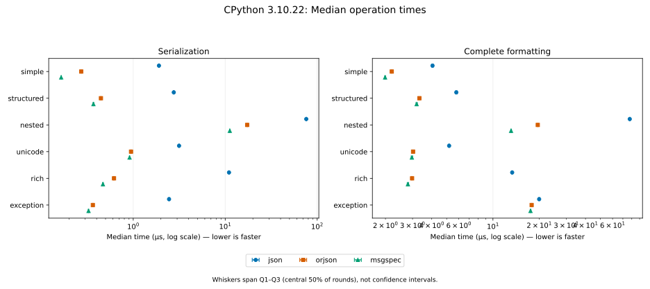

| Layer | Workload | Encoder | Median (µs) | IQR (µs) | Mean ± SD (µs) | Rounds × iterations |
| --- | --- | --- | ---: | ---: | ---: | ---: |
| serialization | simple | json | 1.9 | 0.035 | 1.94 ± 0.24 | 53,311 × 10 |
| serialization | simple | orjson | 0.272 | 0.0063 | 0.277 ± 0.039 | 200,000 × 18 |
| serialization | simple | msgspec | 0.165 | 0.0016 | 0.167 ± 0.014 | 62,446 × 100 |
| serialization | structured | json | 2.76 | 0.061 | 2.81 ± 0.41 | 190,549 × 2 |
| serialization | structured | orjson | 0.446 | 0.01 | 0.451 ± 0.062 | 196,156 × 12 |
| serialization | structured | msgspec | 0.369 | 0.008 | 0.375 ± 0.049 | 186,324 × 15 |
| serialization | nested | json | 76.1 | 0.92 | 76.9 ± 3.3 | 13,479 × 1 |
| serialization | nested | orjson | 17.3 | 0.19 | 17.7 ± 1.7 | 60,409 × 1 |
| serialization | nested | msgspec | 11.2 | 0.15 | 11.5 ± 1.3 | 93,232 × 1 |
| serialization | unicode | json | 3.15 | 0.05 | 3.2 ± 0.43 | 165,865 × 2 |
| serialization | unicode | orjson | 0.946 | 0.01 | 0.966 ± 0.12 | 106,000 × 10 |
| serialization | unicode | msgspec | 0.912 | 0.01 | 0.923 ± 0.087 | 111,446 × 10 |
| serialization | rich | json | 11 | 0.16 | 11.1 ± 0.95 | 94,207 × 1 |
| serialization | rich | orjson | 0.618 | 0.014 | 0.625 ± 0.071 | 170,387 × 10 |
| serialization | rich | msgspec | 0.468 | 0.012 | 0.473 ± 0.052 | 188,395 × 12 |
| serialization | exception | json | 2.45 | 0.04 | 2.49 ± 0.17 | 42,113 × 10 |
| serialization | exception | orjson | 0.364 | 0.006 | 0.368 ± 0.041 | 190,913 × 15 |
| serialization | exception | msgspec | 0.327 | 0.0056 | 0.33 ± 0.038 | 198,099 × 16 |
| formatting | simple | json | 4.05 | 0.085 | 4.1 ± 0.41 | 133,851 × 2 |
| formatting | simple | orjson | 2.2 | 0.033 | 2.22 ± 0.14 | 47,777 × 10 |
| formatting | simple | msgspec | 1.99 | 0.028 | 2.01 ± 0.13 | 51,391 × 10 |
| formatting | structured | json | 5.78 | 0.12 | 5.86 ± 0.69 | 181,555 × 1 |
| formatting | structured | orjson | 3.32 | 0.07 | 3.36 ± 0.36 | 158,479 × 2 |
| formatting | structured | msgspec | 3.19 | 0.065 | 3.22 ± 0.33 | 165,317 × 2 |
| formatting | nested | json | 77.6 | 0.92 | 78.6 ± 3.8 | 13,049 × 1 |
| formatting | nested | orjson | 19.6 | 0.24 | 19.8 ± 1.3 | 54,741 × 1 |
| formatting | nested | msgspec | 13.1 | 0.16 | 13.3 ± 0.98 | 78,933 × 1 |
| formatting | unicode | json | 5.19 | 0.085 | 5.26 ± 0.57 | 100,655 × 2 |
| formatting | unicode | orjson | 3.02 | 0.065 | 3.07 ± 0.4 | 174,247 × 2 |
| formatting | unicode | msgspec | 2.97 | 0.065 | 3.01 ± 0.35 | 176,741 × 2 |
| formatting | rich | json | 13.3 | 0.19 | 13.7 ± 1.6 | 76,162 × 1 |
| formatting | rich | orjson | 2.98 | 0.06 | 3.01 ± 0.34 | 175,501 × 2 |
| formatting | rich | msgspec | 2.8 | 0.06 | 2.83 ± 0.31 | 190,549 × 2 |
| formatting | exception | json | 20 | 0.25 | 20.3 ± 1.6 | 51,285 × 1 |
| formatting | exception | orjson | 17.9 | 0.23 | 18.1 ± 1.4 | 57,985 × 1 |
| formatting | exception | msgspec | 17.6 | 0.23 | 17.8 ± 1.4 | 58,631 × 1 |

#### Speedup

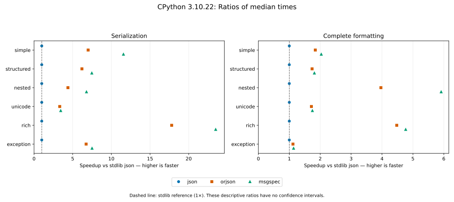

| Layer | Workload | json | orjson | msgspec |
| --- | --- | ---: | ---: | ---: |
| serialization | simple | 1× | 7× | 12× |
| serialization | structured | 1× | 6.2× | 7.5× |
| serialization | nested | 1× | 4.4× | 6.8× |
| serialization | unicode | 1× | 3.3× | 3.5× |
| serialization | rich | 1× | 18× | 23× |
| serialization | exception | 1× | 6.7× | 7.5× |
| formatting | simple | 1× | 1.8× | 2× |
| formatting | structured | 1× | 1.7× | 1.8× |
| formatting | nested | 1× | 4× | 5.9× |
| formatting | unicode | 1× | 1.7× | 1.7× |
| formatting | rich | 1× | 4.5× | 4.8× |
| formatting | exception | 1× | 1.1× | 1.1× |

### CPython 3.11.17

Measured: 2026-10-18T08:15:31.592684+00:00. Revision: `cc23c334a5f68097995128bc3a2b2aaddb20df8f`.

Environment: Linux 6.17.0-1022-azure, x86_64; INTEL(R) XEON(R) PLATINUM 8573C.

Dependencies: `msgspec==0.22.0`, `orjson==3.13.0`, `pytest==9.1.1`, `pytest-benchmark==5.3.0`, `python-json-logger==4.2.1.dev1`.

#### Times and variation

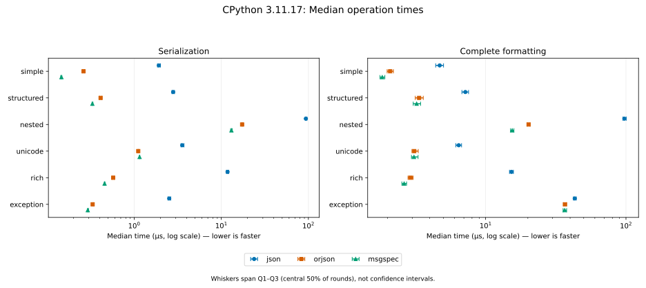

| Layer | Workload | Encoder | Median (µs) | IQR (µs) | Mean ± SD (µs) | Rounds × iterations |
| --- | --- | --- | ---: | ---: | ---: | ---: |
| serialization | simple | json | 1.92 | 0.15 | 1.96 ± 0.21 | 57,807 × 10 |
| serialization | simple | orjson | 0.262 | 0.011 | 0.267 ± 0.064 | 199,124 × 20 |
| serialization | simple | msgspec | 0.146 | 0.0045 | 0.149 ± 0.021 | 71,927 × 100 |
| serialization | structured | json | 2.8 | 0.19 | 2.89 ± 0.42 | 39,997 × 10 |
| serialization | structured | orjson | 0.411 | 0.024 | 0.422 ± 0.067 | 184,639 × 14 |
| serialization | structured | msgspec | 0.331 | 0.0082 | 0.337 ± 0.045 | 194,326 × 16 |
| serialization | nested | json | 93.5 | 4.1 | 95 ± 5 | 11,279 × 1 |
| serialization | nested | orjson | 17.3 | 0.46 | 17.6 ± 1.3 | 59,745 × 1 |
| serialization | nested | msgspec | 13.1 | 0.56 | 13.3 ± 1.6 | 83,195 × 1 |
| serialization | unicode | json | 3.56 | 0.28 | 3.65 ± 0.54 | 160,850 × 2 |
| serialization | unicode | orjson | 1.11 | 0.019 | 1.13 ± 0.12 | 91,425 × 10 |
| serialization | unicode | msgspec | 1.15 | 0.014 | 1.17 ± 0.14 | 88,036 × 10 |
| serialization | rich | json | 11.8 | 0.74 | 11.9 ± 1.4 | 103,864 × 1 |
| serialization | rich | orjson | 0.573 | 0.025 | 0.584 ± 0.086 | 185,667 × 10 |
| serialization | rich | msgspec | 0.457 | 0.008 | 0.465 ± 0.07 | 188,041 × 12 |
| serialization | exception | json | 2.52 | 0.19 | 2.57 ± 0.25 | 43,384 × 10 |
| serialization | exception | orjson | 0.333 | 0.012 | 0.34 ± 0.046 | 195,351 × 16 |
| serialization | exception | msgspec | 0.293 | 0.0082 | 0.299 ± 0.043 | 194,062 × 18 |
| formatting | simple | json | 4.71 | 0.61 | 4.77 ± 0.7 | 139,432 × 2 |
| formatting | simple | orjson | 2.09 | 0.21 | 2.12 ± 0.23 | 57,674 × 10 |
| formatting | simple | msgspec | 1.83 | 0.15 | 1.88 ± 0.25 | 63,132 × 10 |
| formatting | structured | json | 7.17 | 0.78 | 7.25 ± 1 | 184,400 × 1 |
| formatting | structured | orjson | 3.36 | 0.44 | 3.43 ± 0.51 | 181,885 × 2 |
| formatting | structured | msgspec | 3.23 | 0.39 | 3.3 ± 0.51 | 180,506 × 2 |
| formatting | nested | json | 97.4 | 5.3 | 98.6 ± 6.7 | 10,989 × 1 |
| formatting | nested | orjson | 20.2 | 0.92 | 20.5 ± 1.6 | 52,535 × 1 |
| formatting | nested | msgspec | 15.5 | 0.86 | 15.6 ± 1.3 | 71,470 × 1 |
| formatting | unicode | json | 6.43 | 0.61 | 6.5 ± 0.74 | 96,386 × 2 |
| formatting | unicode | orjson | 3.1 | 0.32 | 3.21 ± 0.52 | 183,756 × 2 |
| formatting | unicode | msgspec | 3.09 | 0.34 | 3.18 ± 0.48 | 183,925 × 2 |
| formatting | rich | json | 15.3 | 0.98 | 15.5 ± 1.6 | 78,884 × 1 |
| formatting | rich | orjson | 2.92 | 0.24 | 2.95 ± 0.27 | 42,741 × 10 |
| formatting | rich | msgspec | 2.63 | 0.21 | 2.66 ± 0.24 | 44,534 × 10 |
| formatting | exception | json | 43.2 | 2 | 43.9 ± 3.5 | 26,004 × 1 |
| formatting | exception | orjson | 36.7 | 2 | 37.3 ± 2.8 | 30,906 × 1 |
| formatting | exception | msgspec | 36.6 | 2.2 | 37.2 ± 3.1 | 31,486 × 1 |

#### Speedup

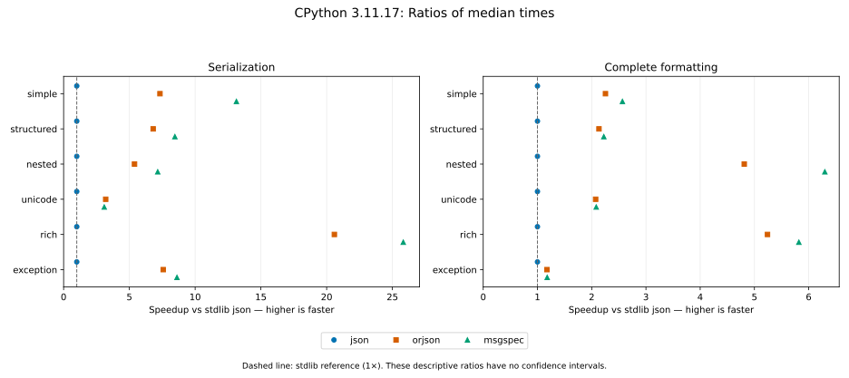

| Layer | Workload | json | orjson | msgspec |
| --- | --- | ---: | ---: | ---: |
| serialization | simple | 1× | 7.3× | 13× |
| serialization | structured | 1× | 6.8× | 8.5× |
| serialization | nested | 1× | 5.4× | 7.2× |
| serialization | unicode | 1× | 3.2× | 3.1× |
| serialization | rich | 1× | 21× | 26× |
| serialization | exception | 1× | 7.6× | 8.6× |
| formatting | simple | 1× | 2.3× | 2.6× |
| formatting | structured | 1× | 2.1× | 2.2× |
| formatting | nested | 1× | 4.8× | 6.3× |
| formatting | unicode | 1× | 2.1× | 2.1× |
| formatting | rich | 1× | 5.2× | 5.8× |
| formatting | exception | 1× | 1.2× | 1.2× |

### CPython 3.12.3

Measured: 2026-10-18T08:15:21.659968+00:00. Revision: `cc23c334a5f68097995128bc3a2b2aaddb20df8f`.

Environment: Linux 6.17.0-1022-azure, x86_64; INTEL(R) XEON(R) PLATINUM 8573C.

Dependencies: `msgspec==0.22.0`, `orjson==3.13.0`, `pytest==9.1.1`, `pytest-benchmark==5.3.0`, `python-json-logger==4.2.1.dev1`.

#### Times and variation

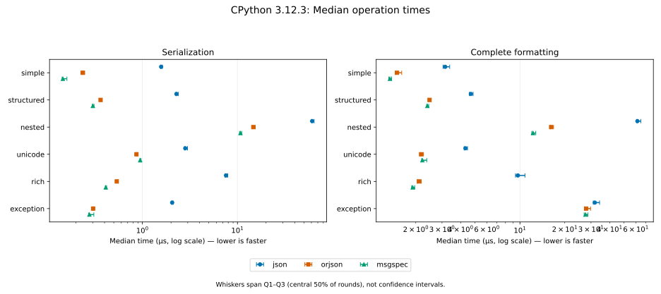

| Layer | Workload | Encoder | Median (µs) | IQR (µs) | Mean ± SD (µs) | Rounds × iterations |
| --- | --- | --- | ---: | ---: | ---: | ---: |
| serialization | simple | json | 1.57 | 0.063 | 1.65 ± 0.25 | 66,086 × 10 |
| serialization | simple | orjson | 0.235 | 0.014 | 0.245 ± 0.023 | 43,294 × 100 |
| serialization | simple | msgspec | 0.146 | 0.018 | 0.152 ± 0.016 | 71,353 × 100 |
| serialization | structured | json | 2.28 | 0.13 | 2.37 ± 0.22 | 45,577 × 10 |
| serialization | structured | orjson | 0.363 | 0.018 | 0.379 ± 0.066 | 168,351 × 15 |
| serialization | structured | msgspec | 0.301 | 0.012 | 0.319 ± 0.078 | 190,115 × 18 |
| serialization | nested | json | 61.1 | 3.4 | 63.8 ± 7.9 | 16,872 × 1 |
| serialization | nested | orjson | 14.7 | 0.85 | 15.4 ± 1.7 | 71,845 × 1 |
| serialization | nested | msgspec | 10.8 | 0.56 | 11 ± 1.1 | 102,638 × 1 |
| serialization | unicode | json | 2.83 | 0.21 | 3.03 ± 1.1 | 190,223 × 2 |
| serialization | unicode | orjson | 0.866 | 0.029 | 0.897 ± 0.13 | 117,330 × 10 |
| serialization | unicode | msgspec | 0.947 | 0.026 | 0.989 ± 0.17 | 107,262 × 10 |
| serialization | rich | json | 7.58 | 0.5 | 7.85 ± 1.2 | 144,823 × 1 |
| serialization | rich | orjson | 0.538 | 0.026 | 0.558 ± 0.088 | 192,197 × 10 |
| serialization | rich | msgspec | 0.412 | 0.012 | 0.425 ± 0.058 | 194,138 × 13 |
| serialization | exception | json | 2.06 | 0.07 | 2.12 ± 0.2 | 50,221 × 10 |
| serialization | exception | orjson | 0.303 | 0.0059 | 0.312 ± 0.039 | 199,204 × 17 |
| serialization | exception | msgspec | 0.277 | 0.036 | 0.296 ± 0.091 | 197,434 × 19 |
| formatting | simple | json | 3.15 | 0.33 | 3.26 ± 0.48 | 181,226 × 2 |
| formatting | simple | orjson | 1.5 | 0.15 | 1.56 ± 0.25 | 73,036 × 10 |
| formatting | simple | msgspec | 1.34 | 0.058 | 1.38 ± 0.17 | 78,946 × 10 |
| formatting | structured | json | 4.68 | 0.27 | 4.83 ± 0.65 | 114,864 × 2 |
| formatting | structured | orjson | 2.47 | 0.097 | 2.54 ± 0.23 | 42,726 × 10 |
| formatting | structured | msgspec | 2.39 | 0.075 | 2.46 ± 0.22 | 43,818 × 10 |
| formatting | nested | json | 61.4 | 3.8 | 63.4 ± 4.4 | 16,633 × 1 |
| formatting | nested | orjson | 16.2 | 0.77 | 16.8 ± 1.6 | 65,100 × 1 |
| formatting | nested | msgspec | 12.2 | 0.77 | 12.8 ± 2.4 | 88,740 × 1 |
| formatting | unicode | json | 4.31 | 0.22 | 4.47 ± 1 | 127,098 × 2 |
| formatting | unicode | orjson | 2.17 | 0.11 | 2.24 ± 0.2 | 48,131 × 10 |
| formatting | unicode | msgspec | 2.21 | 0.18 | 2.36 ± 0.45 | 46,716 × 10 |
| formatting | rich | json | 9.68 | 1.5 | 10.3 ± 2.6 | 116,673 × 1 |
| formatting | rich | orjson | 2.1 | 0.12 | 2.17 ± 0.31 | 51,269 × 10 |
| formatting | rich | msgspec | 1.91 | 0.092 | 1.99 ± 0.29 | 56,748 × 10 |
| formatting | exception | json | 31.8 | 3.2 | 33.5 ± 5.9 | 34,570 × 1 |
| formatting | exception | orjson | 27.8 | 2.7 | 29 ± 3.8 | 39,636 × 1 |
| formatting | exception | msgspec | 27.6 | 1.6 | 28.4 ± 2.7 | 40,714 × 1 |

#### Speedup

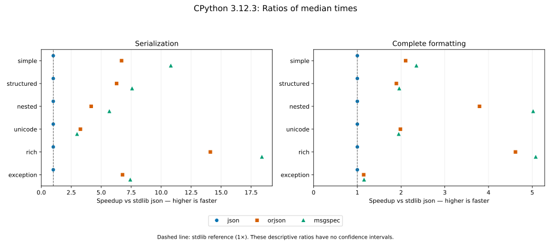

| Layer | Workload | json | orjson | msgspec |
| --- | --- | ---: | ---: | ---: |
| serialization | simple | 1× | 6.7× | 11× |
| serialization | structured | 1× | 6.3× | 7.6× |
| serialization | nested | 1× | 4.2× | 5.7× |
| serialization | unicode | 1× | 3.3× | 3× |
| serialization | rich | 1× | 14× | 18× |
| serialization | exception | 1× | 6.8× | 7.4× |
| formatting | simple | 1× | 2.1× | 2.4× |
| formatting | structured | 1× | 1.9× | 2× |
| formatting | nested | 1× | 3.8× | 5× |
| formatting | unicode | 1× | 2× | 1.9× |
| formatting | rich | 1× | 4.6× | 5.1× |
| formatting | exception | 1× | 1.1× | 1.2× |

### CPython 3.13.16

Measured: 2026-10-18T08:15:25.050587+00:00. Revision: `cc23c334a5f68097995128bc3a2b2aaddb20df8f`.

Environment: Linux 6.17.0-1022-azure, x86_64; AMD EPYC 7763 64-Core Processor.

Dependencies: `msgspec==0.22.0`, `orjson==3.13.0`, `pytest==9.1.1`, `pytest-benchmark==5.3.0`, `python-json-logger==4.2.1.dev1`.

#### Times and variation

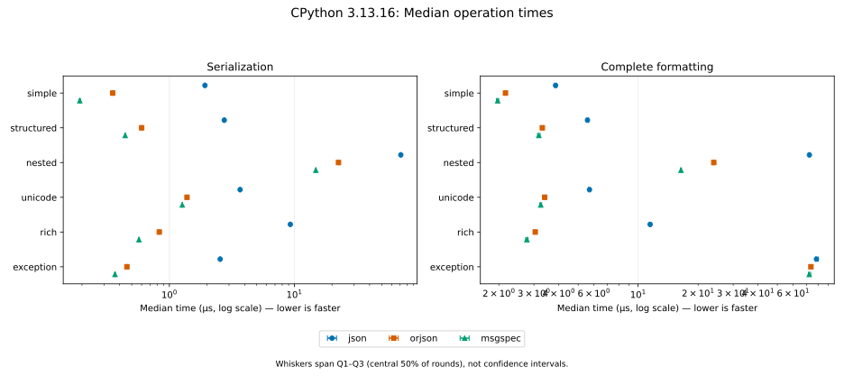

| Layer | Workload | Encoder | Median (µs) | IQR (µs) | Mean ± SD (µs) | Rounds × iterations |
| --- | --- | --- | ---: | ---: | ---: | ---: |
| serialization | simple | json | 1.93 | 0.026 | 1.95 ± 0.16 | 53,926 × 10 |
| serialization | simple | orjson | 0.352 | 0.0074 | 0.358 ± 0.054 | 187,618 × 16 |
| serialization | simple | msgspec | 0.192 | 0.0036 | 0.195 ± 0.016 | 54,278 × 100 |
| serialization | structured | json | 2.75 | 0.05 | 2.8 ± 0.48 | 190,115 × 2 |
| serialization | structured | orjson | 0.6 | 0.015 | 0.613 ± 0.1 | 174,490 × 10 |
| serialization | structured | msgspec | 0.443 | 0.0067 | 0.451 ± 0.075 | 195,695 × 12 |
| serialization | nested | json | 71.1 | 0.51 | 72.2 ± 4.1 | 14,203 × 1 |
| serialization | nested | orjson | 22.6 | 0.19 | 22.8 ± 1.6 | 45,104 × 1 |
| serialization | nested | msgspec | 14.8 | 0.17 | 15.1 ± 1.5 | 69,320 × 1 |
| serialization | unicode | json | 3.68 | 0.055 | 3.76 ± 0.62 | 139,802 × 2 |
| serialization | unicode | orjson | 1.38 | 0.012 | 1.41 ± 0.15 | 73,606 × 10 |
| serialization | unicode | msgspec | 1.27 | 0.007 | 1.28 ± 0.13 | 78,964 × 10 |
| serialization | rich | json | 9.29 | 0.16 | 9.49 ± 1.4 | 112,906 × 1 |
| serialization | rich | orjson | 0.831 | 0.016 | 0.845 ± 0.12 | 127,162 × 10 |
| serialization | rich | msgspec | 0.571 | 0.01 | 0.578 ± 0.076 | 183,151 × 10 |
| serialization | exception | json | 2.55 | 0.037 | 2.59 ± 0.34 | 135,081 × 3 |
| serialization | exception | orjson | 0.457 | 0.0075 | 0.464 ± 0.065 | 188,680 × 12 |
| serialization | exception | msgspec | 0.367 | 0.006 | 0.374 ± 0.059 | 187,266 × 15 |
| formatting | simple | json | 3.85 | 0.085 | 3.91 ± 0.51 | 137,099 × 2 |
| formatting | simple | orjson | 2.16 | 0.038 | 2.19 ± 0.19 | 48,499 × 10 |
| formatting | simple | msgspec | 1.97 | 0.051 | 2 ± 0.2 | 53,637 × 10 |
| formatting | structured | json | 5.57 | 0.14 | 5.68 ± 0.97 | 190,115 × 1 |
| formatting | structured | orjson | 3.31 | 0.079 | 3.35 ± 0.46 | 159,185 × 2 |
| formatting | structured | msgspec | 3.18 | 0.095 | 3.22 ± 0.47 | 167,758 × 2 |
| formatting | nested | json | 72.4 | 0.71 | 73.7 ± 5.8 | 14,189 × 1 |
| formatting | nested | orjson | 24 | 0.24 | 24.3 ± 2 | 42,528 × 1 |
| formatting | nested | msgspec | 16.4 | 0.17 | 16.6 ± 1.6 | 62,579 × 1 |
| formatting | unicode | json | 5.7 | 0.12 | 5.81 ± 1.1 | 184,163 × 1 |
| formatting | unicode | orjson | 3.4 | 0.06 | 3.46 ± 0.51 | 154,298 × 2 |
| formatting | unicode | msgspec | 3.25 | 0.07 | 3.29 ± 0.47 | 161,005 × 2 |
| formatting | rich | json | 11.5 | 0.2 | 11.8 ± 1.9 | 91,158 × 1 |
| formatting | rich | orjson | 3.05 | 0.07 | 3.09 ± 0.46 | 174,826 × 2 |
| formatting | rich | msgspec | 2.76 | 0.079 | 2.81 ± 0.45 | 191,571 × 2 |
| formatting | exception | json | 78.5 | 2.3 | 81.6 ± 8.4 | 13,224 × 1 |
| formatting | exception | orjson | 73.7 | 2.3 | 76.8 ± 8.7 | 14,142 × 1 |
| formatting | exception | msgspec | 72.2 | 1.9 | 75.3 ± 8.7 | 14,266 × 1 |

#### Speedup

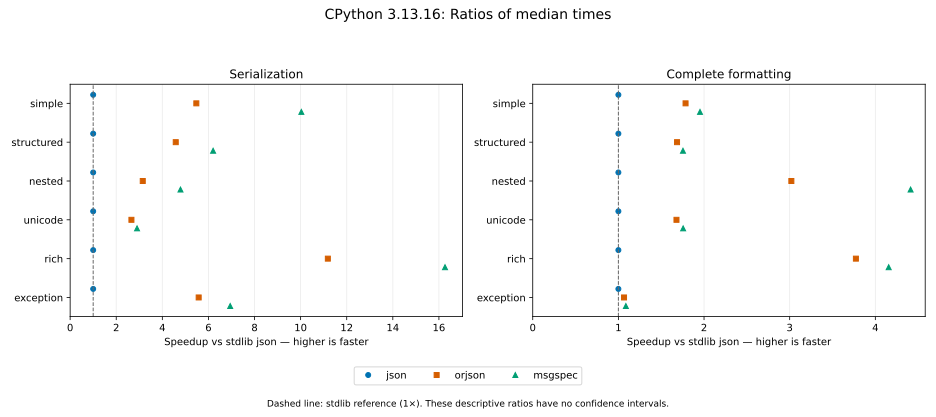

| Layer | Workload | json | orjson | msgspec |
| --- | --- | ---: | ---: | ---: |
| serialization | simple | 1× | 5.5× | 10× |
| serialization | structured | 1× | 4.6× | 6.2× |
| serialization | nested | 1× | 3.2× | 4.8× |
| serialization | unicode | 1× | 2.7× | 2.9× |
| serialization | rich | 1× | 11× | 16× |
| serialization | exception | 1× | 5.6× | 6.9× |
| formatting | simple | 1× | 1.8× | 2× |
| formatting | structured | 1× | 1.7× | 1.8× |
| formatting | nested | 1× | 3× | 4.4× |
| formatting | unicode | 1× | 1.7× | 1.8× |
| formatting | rich | 1× | 3.8× | 4.2× |
| formatting | exception | 1× | 1.1× | 1.1× |

### CPython 3.14.8

Measured: 2026-10-18T08:15:17.678283+00:00. Revision: `cc23c334a5f68097995128bc3a2b2aaddb20df8f`.

Environment: Linux 6.17.0-1022-azure, x86_64; AMD EPYC 9V74 80-Core Processor.

Dependencies: `msgspec==0.22.0`, `orjson==3.13.0`, `pytest==9.1.1`, `pytest-benchmark==5.3.0`, `python-json-logger==4.2.1.dev1`.

#### Times and variation

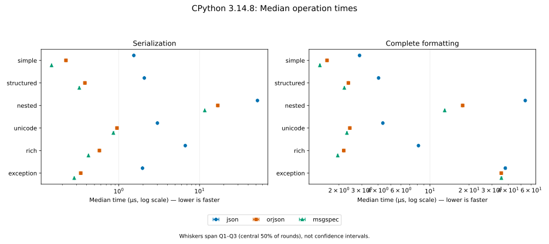

| Layer | Workload | Encoder | Median (µs) | IQR (µs) | Mean ± SD (µs) | Rounds × iterations |
| --- | --- | --- | ---: | ---: | ---: | ---: |
| serialization | simple | json | 1.54 | 0.015 | 1.55 ± 0.11 | 66,393 × 10 |
| serialization | simple | orjson | 0.222 | 0.003 | 0.228 ± 0.019 | 46,079 × 100 |
| serialization | simple | msgspec | 0.147 | 0.0011 | 0.149 ± 0.011 | 69,009 × 100 |
| serialization | structured | json | 2.07 | 0.02 | 2.1 ± 0.18 | 49,481 × 10 |
| serialization | structured | orjson | 0.38 | 0.0086 | 0.389 ± 0.049 | 195,046 × 14 |
| serialization | structured | msgspec | 0.325 | 0.0054 | 0.328 ± 0.038 | 189,826 × 17 |
| serialization | nested | json | 52.1 | 0.37 | 52.8 ± 2.7 | 19,618 × 1 |
| serialization | nested | orjson | 16.8 | 0.19 | 17 ± 1.2 | 61,073 × 1 |
| serialization | nested | msgspec | 11.6 | 0.13 | 11.7 ± 0.98 | 88,293 × 1 |
| serialization | unicode | json | 3.01 | 0.03 | 3.05 ± 0.37 | 171,557 × 2 |
| serialization | unicode | orjson | 0.95 | 0.018 | 0.968 ± 0.11 | 108,649 × 10 |
| serialization | unicode | msgspec | 0.857 | 0.02 | 0.873 ± 0.084 | 119,589 × 10 |
| serialization | rich | json | 6.66 | 0.091 | 6.75 ± 0.75 | 157,011 × 1 |
| serialization | rich | orjson | 0.576 | 0.009 | 0.582 ± 0.063 | 180,571 × 10 |
| serialization | rich | msgspec | 0.421 | 0.0069 | 0.429 ± 0.059 | 195,389 × 13 |
| serialization | exception | json | 1.97 | 0.017 | 2 ± 0.18 | 52,527 × 10 |
| serialization | exception | orjson | 0.338 | 0.0044 | 0.342 ± 0.038 | 190,913 × 16 |
| serialization | exception | msgspec | 0.281 | 0.0032 | 0.284 ± 0.03 | 191,645 × 19 |
| formatting | simple | json | 2.88 | 0.05 | 2.93 ± 0.36 | 182,216 × 2 |
| formatting | simple | orjson | 1.62 | 0.026 | 1.64 ± 0.12 | 64,839 × 10 |
| formatting | simple | msgspec | 1.43 | 0.025 | 1.44 ± 0.1 | 72,047 × 10 |
| formatting | structured | json | 4.03 | 0.06 | 4.08 ± 0.43 | 128,519 × 2 |
| formatting | structured | orjson | 2.36 | 0.029 | 2.38 ± 0.13 | 43,682 × 10 |
| formatting | structured | msgspec | 2.2 | 0.024 | 2.22 ± 0.13 | 46,681 × 10 |
| formatting | nested | json | 54 | 0.42 | 54.7 ± 2.6 | 18,862 × 1 |
| formatting | nested | orjson | 17.8 | 0.14 | 18 ± 1.3 | 57,189 × 1 |
| formatting | nested | msgspec | 13 | 0.18 | 13.1 ± 0.97 | 78,753 × 1 |
| formatting | unicode | json | 4.35 | 0.046 | 4.4 ± 0.44 | 119,162 × 2 |
| formatting | unicode | orjson | 2.42 | 0.031 | 2.45 ± 0.15 | 42,420 × 10 |
| formatting | unicode | msgspec | 2.3 | 0.03 | 2.33 ± 0.16 | 44,380 × 10 |
| formatting | rich | json | 8.16 | 0.11 | 8.38 ± 2.1 | 127,373 × 1 |
| formatting | rich | orjson | 2.18 | 0.028 | 2.2 ± 0.14 | 46,747 × 10 |
| formatting | rich | msgspec | 1.96 | 0.025 | 1.98 ± 0.12 | 52,499 × 10 |
| formatting | exception | json | 37.9 | 0.9 | 39 ± 4.3 | 27,691 × 1 |
| formatting | exception | orjson | 35.3 | 0.65 | 36.1 ± 3 | 29,534 × 1 |
| formatting | exception | msgspec | 35.4 | 0.63 | 36.2 ± 3.4 | 29,386 × 1 |

#### Speedup

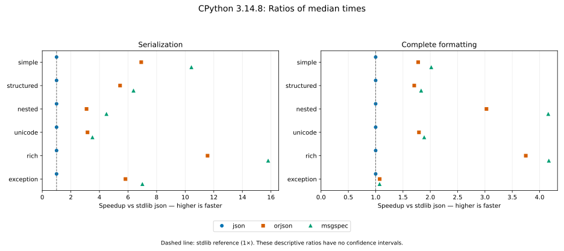

| Layer | Workload | json | orjson | msgspec |
| --- | --- | ---: | ---: | ---: |
| serialization | simple | 1× | 6.9× | 10× |
| serialization | structured | 1× | 5.4× | 6.4× |
| serialization | nested | 1× | 3.1× | 4.5× |
| serialization | unicode | 1× | 3.2× | 3.5× |
| serialization | rich | 1× | 12× | 16× |
| serialization | exception | 1× | 5.8× | 7× |
| formatting | simple | 1× | 1.8× | 2× |
| formatting | structured | 1× | 1.7× | 1.8× |
| formatting | nested | 1× | 3× | 4.2× |
| formatting | unicode | 1× | 1.8× | 1.9× |
| formatting | rich | 1× | 3.7× | 4.2× |
| formatting | exception | 1× | 1.1× | 1.1× |

### CPython 3.15.0

Measured: 2026-10-18T08:15:13.731617+00:00. Revision: `cc23c334a5f68097995128bc3a2b2aaddb20df8f`.

Environment: Linux 6.17.0-1022-azure, x86_64; AMD EPYC 9V45 96-Core Processor.

Dependencies: `msgspec==0.22.0`, `orjson==3.13.0`, `pytest==9.1.1`, `pytest-benchmark==5.3.0`, `python-json-logger==4.2.1.dev1`.

#### Times and variation

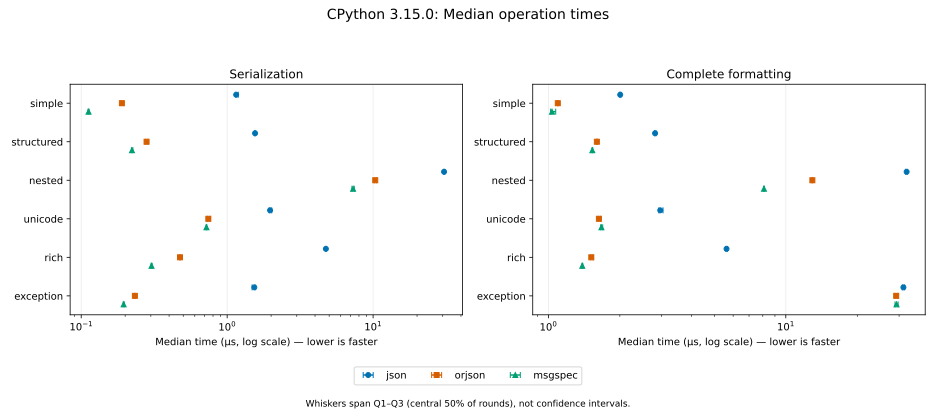

| Layer | Workload | Encoder | Median (µs) | IQR (µs) | Mean ± SD (µs) | Rounds × iterations |
| --- | --- | --- | ---: | ---: | ---: | ---: |
| serialization | simple | json | 1.15 | 0.045 | 1.2 ± 0.49 | 87,743 × 10 |
| serialization | simple | orjson | 0.19 | 0.0066 | 0.193 ± 0.018 | 52,442 × 100 |
| serialization | simple | msgspec | 0.112 | 0.002 | 0.113 ± 0.0095 | 92,065 × 100 |
| serialization | structured | json | 1.55 | 0.03 | 1.6 ± 0.2 | 65,994 × 10 |
| serialization | structured | orjson | 0.28 | 0.011 | 0.284 ± 0.036 | 192,419 × 19 |
| serialization | structured | msgspec | 0.223 | 0.0051 | 0.228 ± 0.022 | 42,472 × 100 |
| serialization | nested | json | 30.6 | 0.48 | 31.1 ± 1.8 | 33,117 × 1 |
| serialization | nested | orjson | 10.3 | 0.32 | 10.6 ± 1.3 | 99,951 × 1 |
| serialization | nested | msgspec | 7.29 | 0.27 | 7.37 ± 0.72 | 146,628 × 1 |
| serialization | unicode | json | 1.97 | 0.077 | 1.99 ± 0.13 | 51,603 × 10 |
| serialization | unicode | orjson | 0.743 | 0.032 | 0.755 ± 0.089 | 139,063 × 10 |
| serialization | unicode | msgspec | 0.721 | 0.009 | 0.731 ± 0.079 | 145,349 × 10 |
| serialization | rich | json | 4.75 | 0.045 | 4.8 ± 0.42 | 107,829 × 2 |
| serialization | rich | orjson | 0.475 | 0.0045 | 0.479 ± 0.051 | 194,251 × 11 |
| serialization | rich | msgspec | 0.303 | 0.005 | 0.306 ± 0.03 | 191,645 × 18 |
| serialization | exception | json | 1.54 | 0.07 | 1.54 ± 0.1 | 65,518 × 10 |
| serialization | exception | orjson | 0.233 | 0.0031 | 0.235 ± 0.01 | 43,000 × 100 |
| serialization | exception | msgspec | 0.195 | 0.0034 | 0.197 ± 0.011 | 53,568 × 100 |
| formatting | simple | json | 2.01 | 0.024 | 2.03 ± 0.11 | 50,736 × 10 |
| formatting | simple | orjson | 1.1 | 0.0081 | 1.11 ± 0.077 | 92,362 × 10 |
| formatting | simple | msgspec | 1.04 | 0.052 | 1.06 ± 0.084 | 99,345 × 10 |
| formatting | structured | json | 2.81 | 0.04 | 2.85 ± 0.28 | 182,183 × 2 |
| formatting | structured | orjson | 1.6 | 0.013 | 1.61 ± 0.093 | 63,196 × 10 |
| formatting | structured | msgspec | 1.53 | 0.012 | 1.55 ± 0.094 | 66,081 × 10 |
| formatting | nested | json | 32.3 | 0.55 | 32.5 ± 1.5 | 31,499 × 1 |
| formatting | nested | orjson | 12.9 | 0.091 | 12.7 ± 1.1 | 90,934 × 1 |
| formatting | nested | msgspec | 8.09 | 0.07 | 8.17 ± 0.61 | 125,755 × 1 |
| formatting | unicode | json | 2.96 | 0.12 | 3.06 ± 1.3 | 177,684 × 2 |
| formatting | unicode | orjson | 1.63 | 0.035 | 1.66 ± 0.12 | 62,325 × 10 |
| formatting | unicode | msgspec | 1.67 | 0.033 | 1.73 ± 0.55 | 62,368 × 10 |
| formatting | rich | json | 5.63 | 0.079 | 5.69 ± 0.58 | 183,892 × 1 |
| formatting | rich | orjson | 1.52 | 0.037 | 1.54 ± 0.099 | 67,101 × 10 |
| formatting | rich | msgspec | 1.39 | 0.011 | 1.41 ± 0.09 | 73,207 × 10 |
| formatting | exception | json | 31.3 | 0.7 | 31.7 ± 4 | 33,472 × 1 |
| formatting | exception | orjson | 29.2 | 0.84 | 29.8 ± 6.5 | 36,204 × 1 |
| formatting | exception | msgspec | 29.3 | 0.87 | 29.6 ± 5.3 | 36,548 × 1 |

#### Speedup

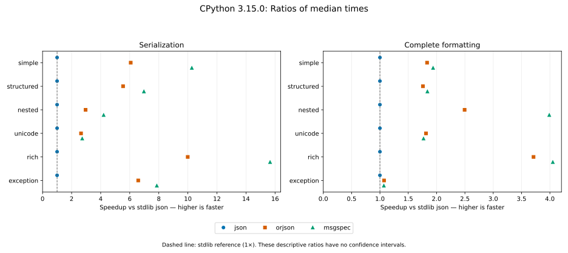

| Layer | Workload | json | orjson | msgspec |
| --- | --- | ---: | ---: | ---: |
| serialization | simple | 1× | 6.1× | 10× |
| serialization | structured | 1× | 5.5× | 7× |
| serialization | nested | 1× | 3× | 4.2× |
| serialization | unicode | 1× | 2.6× | 2.7× |
| serialization | rich | 1× | 10× | 16× |
| serialization | exception | 1× | 6.6× | 7.9× |
| formatting | simple | 1× | 1.8× | 1.9× |
| formatting | structured | 1× | 1.8× | 1.8× |
| formatting | nested | 1× | 2.5× | 4× |
| formatting | unicode | 1× | 1.8× | 1.8× |
| formatting | rich | 1× | 3.7× | 4.1× |
| formatting | exception | 1× | 1.1× | 1.1× |

<!-- benchmark-results:end -->
