# Benchmarking

Compare the default `JsonFormatter`, `OrjsonFormatter`, and `MsgspecFormatter`
with the opt-in benchmark suite. Measurements cover serialization and complete
record formatting. They help you choose a backend for a workload; they do not
predict application throughput or handler I/O performance.

<!-- benchmark-summary:start -->

## Complete-formatting summary

Complete formatting includes record processing and serialization. These results use the [committed baseline](#baseline-results), not application throughput measurements.

Bars show the median across Python versions of each version's median operation time. Whiskers show the minimum–maximum across those versions, not individual timing samples or confidence intervals. Each version has equal weight.

Speedups are calculated against CPython stdlib JSON for the same workload and Python major/minor version, then summarized across versions. They are not ratios of cross-version median times. Only versions with a matching CPython reference contribute to speedups. Values above 1× indicate faster formatting.

Version coverage differs between runtimes, so these summaries do not isolate interpreter performance. The tables list the versions included in each metric.

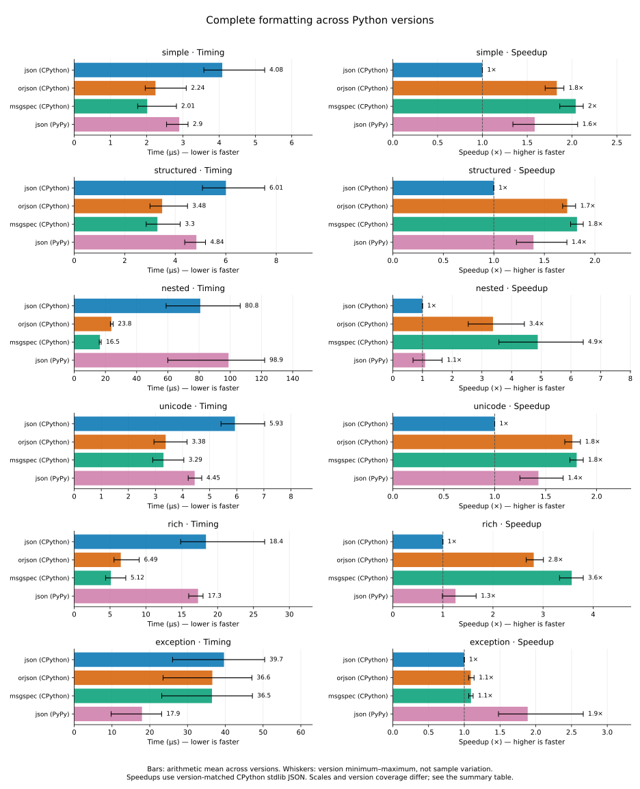

Timing panels: lower is faster. Speedup panels: higher is faster; the dashed line marks 1×. Each panel starts at zero and has its own scale. Open the SVG to view or share the full-size summary.

??? note "Summary values and included versions"

    | Workload | Encoder | Time median [min–max] (µs) | Timing versions | Speedup median [min–max] | Speedup versions |
    | --- | --- | ---: | --- | ---: | --- |
    | simple | json (CPython) | 3.88 [3.58–5.25] | 3.10, 3.11, 3.12, 3.13, 3.14, 3.15 (n=6) | 1× [1–1]× | 3.10, 3.11, 3.12, 3.13, 3.14, 3.15 (n=6) |
    | simple | orjson (CPython) | 2.08 [1.96–3.09] | 3.10, 3.11, 3.12, 3.13, 3.14, 3.15 (n=6) | 1.8× [1.7–1.9]× | 3.10, 3.11, 3.12, 3.13, 3.14, 3.15 (n=6) |
    | simple | msgspec (CPython) | 1.86 [1.75–2.82] | 3.10, 3.11, 3.12, 3.13, 3.14, 3.15 (n=6) | 2.1× [1.9–2.1]× | 3.10, 3.11, 3.12, 3.13, 3.14, 3.15 (n=6) |
    | simple | json (PyPy) | 3 [2.55–3.14] | 3.10, 3.11, 3.12 (n=3) | 1.3× [1.3–2.1]× | 3.10, 3.11, 3.12 (n=3) |
    | structured | json (CPython) | 5.86 [5.08–7.54] | 3.10, 3.11, 3.12, 3.13, 3.14, 3.15 (n=6) | 1× [1–1]× | 3.10, 3.11, 3.12, 3.13, 3.14, 3.15 (n=6) |
    | structured | orjson (CPython) | 3.35 [3–4.49] | 3.10, 3.11, 3.12, 3.13, 3.14, 3.15 (n=6) | 1.7× [1.7–1.8]× | 3.10, 3.11, 3.12, 3.13, 3.14, 3.15 (n=6) |
    | structured | msgspec (CPython) | 3.21 [2.85–4.2] | 3.10, 3.11, 3.12, 3.13, 3.14, 3.15 (n=6) | 1.8× [1.8–1.9]× | 3.10, 3.11, 3.12, 3.13, 3.14, 3.15 (n=6) |
    | structured | json (PyPy) | 4.94 [4.38–5.2] | 3.10, 3.11, 3.12 (n=3) | 1.2× [1.2–1.7]× | 3.10, 3.11, 3.12 (n=3) |
    | nested | json (CPython) | 75.8 [58.9–106] | 3.10, 3.11, 3.12, 3.13, 3.14, 3.15 (n=6) | 1× [1–1]× | 3.10, 3.11, 3.12, 3.13, 3.14, 3.15 (n=6) |
    | nested | orjson (CPython) | 23.6 [23.2–24.9] | 3.10, 3.11, 3.12, 3.13, 3.14, 3.15 (n=6) | 3.2× [2.5–4.4]× | 3.10, 3.11, 3.12, 3.13, 3.14, 3.15 (n=6) |
    | nested | msgspec (CPython) | 16.4 [16.1–17.3] | 3.10, 3.11, 3.12, 3.13, 3.14, 3.15 (n=6) | 4.7× [3.6–6.4]× | 3.10, 3.11, 3.12, 3.13, 3.14, 3.15 (n=6) |
    | nested | json (PyPy) | 115 [60–122] | 3.10, 3.11, 3.12 (n=3) | 0.93× [0.68–1.7]× | 3.10, 3.11, 3.12 (n=3) |
    | unicode | json (CPython) | 5.74 [5.42–7.03] | 3.10, 3.11, 3.12, 3.13, 3.14, 3.15 (n=6) | 1× [1–1]× | 3.10, 3.11, 3.12, 3.13, 3.14, 3.15 (n=6) |
    | unicode | orjson (CPython) | 3.29 [2.94–4.17] | 3.10, 3.11, 3.12, 3.13, 3.14, 3.15 (n=6) | 1.8× [1.7–1.8]× | 3.10, 3.11, 3.12, 3.13, 3.14, 3.15 (n=6) |
    | unicode | msgspec (CPython) | 3.22 [2.9–4.05] | 3.10, 3.11, 3.12, 3.13, 3.14, 3.15 (n=6) | 1.8× [1.7–1.9]× | 3.10, 3.11, 3.12, 3.13, 3.14, 3.15 (n=6) |
    | unicode | json (PyPy) | 4.43 [4.21–4.71] | 3.10, 3.11, 3.12 (n=3) | 1.4× [1.2–1.7]× | 3.10, 3.11, 3.12 (n=3) |
    | rich | json (CPython) | 16.8 [14.8–26.6] | 3.10, 3.11, 3.12, 3.13, 3.14, 3.15 (n=6) | 1× [1–1]× | 3.10, 3.11, 3.12, 3.13, 3.14, 3.15 (n=6) |
    | rich | orjson (CPython) | 6.05 [5.55–9.06] | 3.10, 3.11, 3.12, 3.13, 3.14, 3.15 (n=6) | 2.8× [2.7–3]× | 3.10, 3.11, 3.12, 3.13, 3.14, 3.15 (n=6) |
    | rich | msgspec (CPython) | 4.73 [4.38–7.19] | 3.10, 3.11, 3.12, 3.13, 3.14, 3.15 (n=6) | 3.6× [3.3–3.8]× | 3.10, 3.11, 3.12, 3.13, 3.14, 3.15 (n=6) |
    | rich | json (PyPy) | 17.9 [16–18] | 3.10, 3.11, 3.12 (n=3) | 1.1× [0.99–1.7]× | 3.10, 3.11, 3.12 (n=3) |
    | exception | json (CPython) | 40.5 [26–50.4] | 3.10, 3.11, 3.12, 3.13, 3.14, 3.15 (n=6) | 1× [1–1]× | 3.10, 3.11, 3.12, 3.13, 3.14, 3.15 (n=6) |
    | exception | orjson (CPython) | 37.1 [23.5–47.1] | 3.10, 3.11, 3.12, 3.13, 3.14, 3.15 (n=6) | 1.1× [1.1–1.1]× | 3.10, 3.11, 3.12, 3.13, 3.14, 3.15 (n=6) |
    | exception | msgspec (CPython) | 37.2 [23.2–47.2] | 3.10, 3.11, 3.12, 3.13, 3.14, 3.15 (n=6) | 1.1× [1.1–1.1]× | 3.10, 3.11, 3.12, 3.13, 3.14, 3.15 (n=6) |
    | exception | json (PyPy) | 20.9 [9.77–23.1] | 3.10, 3.11, 3.12 (n=3) | 1.5× [1.5–2.7]× | 3.10, 3.11, 3.12 (n=3) |

<!-- benchmark-summary:end -->

## Run benchmarks

From a repository checkout, install the benchmark dependencies:

```shell
uv sync --python 3.15 --no-default-groups --group benchmark
```

On CPython, this group installs all three backends. On PyPy, it installs only the
stdlib backend and benchmark tools. Cases for unavailable optional encoders are
reported as skipped. The published comparison covers standard
GIL-enabled CPython 3.10–3.15 and PyPy 3.10–3.12. Each published CPython result
must contain all three backends; PyPy results contain stdlib JSON only.

Check every case without collecting performance measurements:

```shell
uv run --no-sync pytest benchmarks --benchmark-disable
```

Collect measurements with warmup and export the results:

```shell
mkdir -p benchmark-results
uv run --no-sync pytest benchmarks --benchmark-warmup=on \
  --benchmark-json=benchmark-results/python-3.15.json
```

You can also use tox with its uv runner:

```shell
uvx --with tox-uv tox -e py315-benchmark
uvx --with tox-uv tox -e pypy312-benchmark
```

Append `-benchmark` to a supported tox runtime name to benchmark that interpreter.
The workflow selects tox's `benchmark` label with `tox -m benchmark`. Ordinary
test and benchmark environments share version lists in `tox.ini`, so supported
versions are maintained in one place. Use `uvx --with tox-uv tox -e benchmark`
to use the default interpreter. Results go to the environment's
`envtmpdir`, such as `.tox/py315-benchmark/tmp/benchmark.json`. Pass pytest options
after `--` to select cases or change measurement settings. For example, use
`-k unicode` to select Unicode workloads. Normal test runs collect only `tests/`
and do not need the benchmark dependencies.

The manual **Benchmark JSON formatters** GitHub Actions workflow runs Linux
x86-64 benchmarks for the supported CPython and PyPy versions. One tox
invocation runs the runtimes sequentially in one job on the same runner.
The job uploads a single artifact containing one JSON file per runtime, and its
summary contains the comparison tables. Timing differences never fail CI.

## Measurement methodology

The suite uses `pytest-benchmark` for pytest integration, automatic calibration,
statistics, and JSON export. Run on an otherwise idle machine, use warmup, and
repeat runs before interpreting small differences. Benchmarks and Python
environments run sequentially; do not run multiple benchmark sessions
concurrently on the same machine.

Each backend uses its default formatter configuration. The two measurement
layers are:

- **Serialization:** `jsonify_log_record()` on a prepared dictionary, including
  bytes-to-string conversion in the `orjson` and `msgspec` formatters.
- **Formatting:** `format(LogRecord)` on a prepared record, including field
  extraction, message handling, exception formatting where applicable, and
  serialization.

Formatter and record construction, payload preparation, correctness checks, and
handler I/O are outside the timed operation. Formatters and records are reused.
Checks before and after measurement verify expected parsed content and
consistent repeated output. Exception records retain `exc_info`, so formatting
includes rendering the traceback on each call; serialization uses prepared
exception text.

| Workload | Payload |
| --- | --- |
| `simple` | A short string message |
| `structured` | A string message with scalar LogRecord extras |
| `nested` | A dictionary message containing 100 objects with lists and nested metrics |
| `unicode` | A repeated message containing accented text, Japanese text, and emoji |
| `rich` | A dictionary message containing a UTC datetime, UUID, dataclass, bytes, an Enum class, and its members |
| `exception` | A message and a prepared ValueError traceback |

Default outputs can differ. Stdlib JSON escapes non-ASCII characters and uses
spaces between elements; the other backends emit compact UTF-8. UTC datetime
strings use `+00:00` for stdlib and orjson, and `Z` for msgspec. These are
comparisons of the supported formatter defaults, including native rich-type
support and fallback encoding costs. They are not byte-identical raw encoder
comparisons. Bytes are encoded as base64 strings; the Enum class is encoded as
a list of member values, and each Enum member is encoded as its value. JSON results
record each case's output size.

## Repetitions, variation, and precision

Warmup and calibration run before timing. `pytest-benchmark` chooses a batch of
iterations per round and repeats those rounds. Statistics describe the
per-operation average duration of each round, rather than individual logging
call latencies. See the [pytest-benchmark glossary](https://pytest-benchmark.readthedocs.io/en/latest/glossary.html).

The generated summary and timing tables record the actual round counts and
iterations per round. Calibration and
warmup calls are additional and are excluded from those counts. Each runtime
has one full suite run; thousands of timing rounds are not thousands of
independent suite runs or machines.

Timing tables show median, arithmetic mean, standard deviation (SD), and
interquartile range (IQR), all in microseconds per operation. IQR is Q3 minus Q1:
the width containing the middle 50% of round averages. Median and IQR are less
sensitive to slow outliers than mean and SD. The JSON also retains minimum,
maximum, quartiles, and outlier counts.

There is no universally trustworthy number of decimal places in microseconds.
The generated summary reports the observed SD relative to the mean, including
outliers. Reported times use at most three significant digits; spreads and speedups use
at most two. This is display rounding, not a claim of accuracy. Batching reduces
timer overhead, but cannot eliminate scheduler, garbage collection, CPU frequency,
or hosted-runner variation. Do not interpret the final displayed digit as a
reliable performance difference. Check IQR and SD, and repeat complete runs on
the same machine before drawing conclusions about small differences.

Timing plots use labeled horizontal bars, with one panel per workload and
measurement layer. Speedup plots use two panels (serialization and complete
formatting), with bars grouped by workload and guides at shared group boundaries.
All axes are linear and start at zero; ranges differ between panels.
Compare bar lengths within a panel; use the numeric labels and tables to compare
workloads. Timing bars show medians without whiskers. IQR and SD remain in the
tables to show within-run variation; they do not measure between-run reproducibility.
Separate speedup tables and plots divide the stdlib median by each backend's
median for the same workload, layer, and Python major/minor version. The
reference is CPython stdlib JSON; a standalone PyPy report uses PyPy stdlib JSON. Values above 1 mean that the
backend was faster in that measurement. Speedups are descriptive ratios without
inferred confidence intervals. Only stdlib JSON is measured on PyPy. All runtimes
in one workflow invocation share the same runner. Runtime versions and
dependencies still differ, and separate invocations can use different hardware.
Comparisons do not isolate interpreter performance. Exact patch versions and
environments are recorded separately.

## Update results

The curated baseline consists of one JSON file per Python implementation and version under
`benchmarks/results/`, collected from one workflow invocation. Later
workflow runs remain artifacts until explicitly selected as a replacement.
Download and extract the `benchmark-results` artifact from the chosen invocation into
`benchmark-results/downloaded/`. Keep each JSON file under its original name.
Curate the files and regenerate the tables:

```shell
python scripts/benchmark_report.py benchmark-results/downloaded/*.json \
  --curate benchmarks/results
python scripts/benchmark_report.py benchmarks/results/*.json \
  --update docs/benchmarking.md --plots assets/benchmarking
uv run --no-default-groups --group benchmark-report \
  python scripts/benchmark_plots.py benchmarks/results/*.json \
  --output docs/assets/benchmarking
```

Curation removes individual timing sample arrays to keep repository files small.
It preserves every summary statistic and records the original file’s SHA-256
hash. Workflow artifacts retain the full samples.

Plot generation uses Matplotlib in the separate `benchmark-report` dependency
group; it adds no dependency to timed benchmark runs or ordinary tests. The SVG
files contain text labels and can be exported or shared separately. Both plot
types are generated from the same committed summaries as the tables.

The generator rejects incomplete or duplicate case matrices. Review the source
revision, dependency versions, measurement settings, and variability before
committing refreshed data. Artifact retention is finite; the committed curated
JSON preserves the measurements used by this page.

## Baseline results

These measurements come from [workflow run 40619767654](https://github.com/nhairs-bot/python-json-logger/actions/runs/40619767654).
Each table records its measured source revision, exact dependency versions, and environment.
Some PyPy rounds take milliseconds despite microsecond medians; these outliers
are retained and can make SD exceed the mean. These measurements do not identify
the cause of the pauses.

<!-- benchmark-results:start -->

Observed repetitions: 8,500–199,721 rounds per case, with 1–100 iterations per round. Warmup and calibration calls are additional.

Within-run SD/mean: 3.9%–5.6e+02% across cases, including outliers. This does not measure between-run variation.

### Python 3.10

**CPython 3.10.22**. Measured: 2026-10-28T02:16:20.354127+00:00. Revision: `3a26fc4e64acfc167d24623c96ccd72802f834d0`.

Environment: Linux 6.17.0-1022-azure, x86_64; AMD EPYC 9V74 80-Core Processor.

Dependencies: `msgspec==0.22.0`, `orjson==3.13.0`, `pytest==9.1.1`, `pytest-benchmark==5.3.0`, `python-json-logger==4.3.0.dev1`.

**PyPy 3.10.16**. Measured: 2026-10-28T02:24:54.543640+00:00. Revision: `3a26fc4e64acfc167d24623c96ccd72802f834d0`.

Environment: Linux 6.17.0-1022-azure, x86_64; AMD EPYC 9V74 80-Core Processor. PyPy release: 7.3.19.

Dependencies: `pytest==9.1.1`, `pytest-benchmark==5.3.0`, `python-json-logger==4.3.0.dev1`.

#### Times and variation

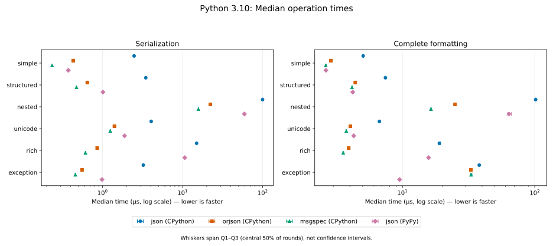

??? note "Timing statistics"

    | Layer | Workload | Encoder | Median (µs) | IQR (µs) | Mean ± SD (µs) | Rounds × iterations |
    | --- | --- | --- | ---: | ---: | ---: | ---: |
    | serialization | simple | json (CPython) | 2.53 | 0.042 | 2.56 ± 0.19 | 41,176 × 10 |
    | serialization | simple | orjson (CPython) | 0.38 | 0.0086 | 0.389 ± 0.068 | 199,323 × 14 |
    | serialization | simple | msgspec (CPython) | 0.218 | 0.0024 | 0.223 ± 0.029 | 47,502 × 100 |
    | serialization | simple | json (PyPy) | 0.373 | 0.013 | 0.384 ± 0.088 | 195,389 × 15 |
    | serialization | structured | json (CPython) | 3.57 | 0.08 | 3.64 ± 0.54 | 146,822 × 2 |
    | serialization | structured | orjson (CPython) | 0.601 | 0.018 | 0.611 ± 0.16 | 176,119 × 10 |
    | serialization | structured | msgspec (CPython) | 0.489 | 0.011 | 0.496 ± 0.077 | 195,389 × 11 |
    | serialization | structured | json (PyPy) | 0.965 | 0.021 | 1.01 ± 4 | 110,828 × 10 |
    | serialization | nested | json (CPython) | 97.1 | 0.97 | 98.5 ± 6.2 | 10,460 × 1 |
    | serialization | nested | orjson (CPython) | 21.7 | 0.2 | 21.9 ± 1.6 | 46,835 × 1 |
    | serialization | nested | msgspec (CPython) | 14.5 | 0.19 | 14.7 ± 2.4 | 71,271 × 1 |
    | serialization | nested | json (PyPy) | 58.2 | 1.1 | 61.2 ± 98 | 17,936 × 1 |
    | serialization | unicode | json (CPython) | 4.11 | 0.066 | 4.2 ± 0.62 | 127,195 × 2 |
    | serialization | unicode | orjson (CPython) | 1.24 | 0.014 | 1.26 ± 0.15 | 83,907 × 10 |
    | serialization | unicode | msgspec (CPython) | 1.17 | 0.013 | 1.19 ± 0.12 | 87,131 × 10 |
    | serialization | unicode | json (PyPy) | 1.79 | 0.024 | 1.84 ± 0.26 | 57,614 × 10 |
    | serialization | rich | json (CPython) | 22.8 | 0.29 | 23.2 ± 2.1 | 45,202 × 1 |
    | serialization | rich | orjson (CPython) | 5.34 | 0.11 | 5.42 ± 0.8 | 196,967 × 1 |
    | serialization | rich | msgspec (CPython) | 3.51 | 0.065 | 3.56 ± 0.46 | 153,847 × 2 |
    | serialization | rich | json (PyPy) | 11.3 | 0.2 | 11.7 ± 29 | 94,823 × 1 |
    | serialization | exception | json (CPython) | 3.28 | 0.065 | 3.35 ± 0.52 | 158,756 × 2 |
    | serialization | exception | orjson (CPython) | 0.486 | 0.015 | 0.494 ± 0.074 | 197,356 × 11 |
    | serialization | exception | msgspec (CPython) | 0.41 | 0.0093 | 0.417 ± 0.066 | 186,290 × 14 |
    | serialization | exception | json (PyPy) | 0.969 | 0.02 | 0.991 ± 0.15 | 109,602 × 10 |
    | formatting | simple | json (CPython) | 5.25 | 0.1 | 5.35 ± 0.68 | 100,960 × 2 |
    | formatting | simple | orjson (CPython) | 3.09 | 0.075 | 3.15 ± 0.46 | 170,970 × 2 |
    | formatting | simple | msgspec (CPython) | 2.82 | 0.065 | 2.86 ± 0.41 | 185,598 × 2 |
    | formatting | simple | json (PyPy) | 2.55 | 0.038 | 2.64 ± 0.82 | 40,606 × 10 |
    | formatting | structured | json (CPython) | 7.54 | 0.16 | 7.67 ± 1 | 140,430 × 1 |
    | formatting | structured | orjson (CPython) | 4.49 | 0.086 | 4.56 ± 0.55 | 115,701 × 2 |
    | formatting | structured | msgspec (CPython) | 4.2 | 0.099 | 4.25 ± 0.49 | 122,820 × 2 |
    | formatting | structured | json (PyPy) | 4.38 | 0.07 | 4.5 ± 2.3 | 121,922 × 2 |
    | formatting | nested | json (CPython) | 99.6 | 1 | 101 ± 4.4 | 10,048 × 1 |
    | formatting | nested | orjson (CPython) | 24.9 | 0.28 | 25.3 ± 1.8 | 41,518 × 1 |
    | formatting | nested | msgspec (CPython) | 17.3 | 0.22 | 17.5 ± 1.5 | 59,720 × 1 |
    | formatting | nested | json (PyPy) | 60 | 1.8 | 64.1 ± 1e+02 | 17,314 × 1 |
    | formatting | unicode | json (CPython) | 7.03 | 0.13 | 7.16 ± 1.1 | 149,254 × 1 |
    | formatting | unicode | orjson (CPython) | 4.17 | 0.07 | 4.24 ± 0.54 | 125,597 × 2 |
    | formatting | unicode | msgspec (CPython) | 4.05 | 0.13 | 4.09 ± 0.52 | 129,333 × 2 |
    | formatting | unicode | json (PyPy) | 4.21 | 0.07 | 4.45 ± 20 | 122,971 × 2 |
    | formatting | rich | json (CPython) | 26.6 | 0.32 | 27 ± 2 | 39,034 × 1 |
    | formatting | rich | orjson (CPython) | 9.06 | 0.14 | 9.19 ± 1.1 | 114,640 × 1 |
    | formatting | rich | msgspec (CPython) | 7.19 | 0.13 | 7.31 ± 0.96 | 144,928 × 1 |
    | formatting | rich | json (PyPy) | 16 | 0.28 | 16.5 ± 3.3 | 66,038 × 1 |
    | formatting | exception | json (CPython) | 26 | 0.36 | 26.5 ± 2.3 | 39,608 × 1 |
    | formatting | exception | orjson (CPython) | 23.5 | 0.31 | 23.9 ± 1.9 | 44,201 × 1 |
    | formatting | exception | msgspec (CPython) | 23.2 | 0.3 | 23.6 ± 2.1 | 44,457 × 1 |
    | formatting | exception | json (PyPy) | 9.77 | 0.17 | 10.7 ± 47 | 106,338 × 1 |

#### Speedup

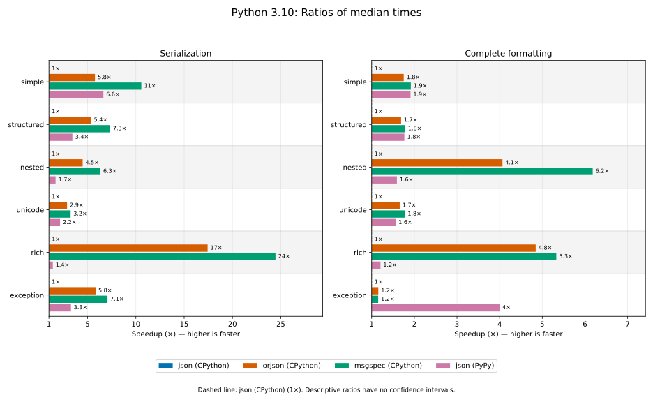

Reference: json (CPython) (1×).

??? note "Speedup values"

    | Layer | Workload | json (CPython) | orjson (CPython) | msgspec (CPython) | json (PyPy) |
    | --- | --- | ---: | ---: | ---: | ---: |
    | serialization | simple | 1× | 6.7× | 12× | 6.8× |
    | serialization | structured | 1× | 5.9× | 7.3× | 3.7× |
    | serialization | nested | 1× | 4.5× | 6.7× | 1.7× |
    | serialization | unicode | 1× | 3.3× | 3.5× | 2.3× |
    | serialization | rich | 1× | 4.3× | 6.5× | 2× |
    | serialization | exception | 1× | 6.8× | 8× | 3.4× |
    | formatting | simple | 1× | 1.7× | 1.9× | 2.1× |
    | formatting | structured | 1× | 1.7× | 1.8× | 1.7× |
    | formatting | nested | 1× | 4× | 5.8× | 1.7× |
    | formatting | unicode | 1× | 1.7× | 1.7× | 1.7× |
    | formatting | rich | 1× | 2.9× | 3.7× | 1.7× |
    | formatting | exception | 1× | 1.1× | 1.1× | 2.7× |

### Python 3.11

**CPython 3.11.18**. Measured: 2026-10-28T02:18:00.061021+00:00. Revision: `3a26fc4e64acfc167d24623c96ccd72802f834d0`.

Environment: Linux 6.17.0-1022-azure, x86_64; AMD EPYC 9V74 80-Core Processor.

Dependencies: `msgspec==0.22.0`, `orjson==3.13.0`, `pytest==9.1.1`, `pytest-benchmark==5.3.0`, `python-json-logger==4.3.0.dev1`.

**PyPy 3.11.17**. Measured: 2026-10-28T02:25:31.091341+00:00. Revision: `3a26fc4e64acfc167d24623c96ccd72802f834d0`.

Environment: Linux 6.17.0-1022-azure, x86_64; AMD EPYC 9V74 80-Core Processor. PyPy release: 8.0.1.

Dependencies: `pytest==9.1.1`, `pytest-benchmark==5.3.0`, `python-json-logger==4.3.0.dev1`.

#### Times and variation

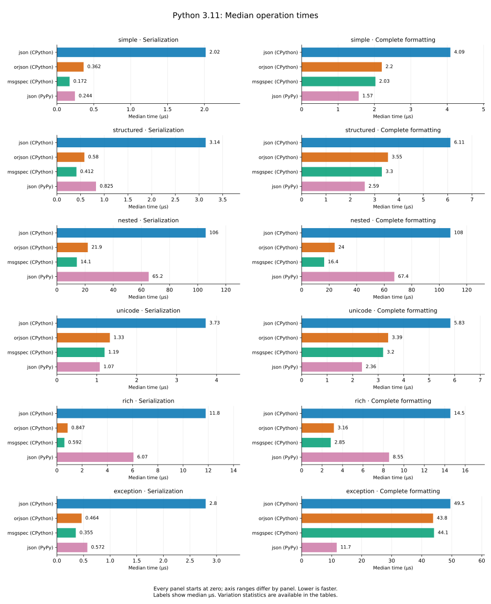

??? note "Timing statistics"

    | Layer | Workload | Encoder | Median (µs) | IQR (µs) | Mean ± SD (µs) | Rounds × iterations |
    | --- | --- | --- | ---: | ---: | ---: | ---: |
    | serialization | simple | json (CPython) | 2.12 | 0.04 | 2.18 ± 0.29 | 48,755 × 10 |
    | serialization | simple | orjson (CPython) | 0.276 | 0.0085 | 0.287 ± 0.098 | 191,278 × 20 |
    | serialization | simple | msgspec (CPython) | 0.165 | 0.002 | 0.169 ± 0.021 | 62,132 × 100 |
    | serialization | simple | json (PyPy) | 0.486 | 0.013 | 0.5 ± 0.31 | 182,183 × 12 |
    | serialization | structured | json (CPython) | 3.25 | 0.07 | 3.34 ± 0.75 | 165,317 × 2 |
    | serialization | structured | orjson (CPython) | 0.477 | 0.012 | 0.486 ± 0.076 | 182,516 × 12 |
    | serialization | structured | msgspec (CPython) | 0.401 | 0.0086 | 0.407 ± 0.058 | 186,986 × 14 |
    | serialization | structured | json (PyPy) | 1.39 | 0.025 | 1.42 ± 0.17 | 75,132 × 10 |
    | serialization | nested | json (CPython) | 104 | 1.2 | 106 ± 4.9 | 9,796 × 1 |
    | serialization | nested | orjson (CPython) | 21.1 | 0.18 | 21.4 ± 1.6 | 48,305 × 1 |
    | serialization | nested | msgspec (CPython) | 14.4 | 0.2 | 14.5 ± 1.3 | 72,569 × 1 |
    | serialization | nested | json (PyPy) | 112 | 1.7 | 117 ± 1.4e+02 | 9,107 × 1 |
    | serialization | unicode | json (CPython) | 3.94 | 0.06 | 4.01 ± 0.57 | 131,909 × 2 |
    | serialization | unicode | orjson (CPython) | 1.29 | 0.017 | 1.31 ± 0.13 | 80,071 × 10 |
    | serialization | unicode | msgspec (CPython) | 1.19 | 0.01 | 1.2 ± 0.12 | 85,347 × 10 |
    | serialization | unicode | json (PyPy) | 1.97 | 0.031 | 2.05 ± 0.48 | 54,804 × 10 |
    | serialization | rich | json (CPython) | 16.7 | 0.23 | 17 ± 1.5 | 61,558 × 1 |
    | serialization | rich | orjson (CPython) | 3.88 | 0.07 | 3.93 ± 0.48 | 134,935 × 2 |
    | serialization | rich | msgspec (CPython) | 2.54 | 0.033 | 2.57 ± 0.19 | 40,706 × 10 |
    | serialization | rich | json (PyPy) | 13.3 | 0.26 | 13.6 ± 1.9 | 78,685 × 1 |
    | serialization | exception | json (CPython) | 2.84 | 0.055 | 2.9 ± 0.49 | 183,554 × 2 |
    | serialization | exception | orjson (CPython) | 0.345 | 0.006 | 0.35 ± 0.052 | 198,492 × 15 |
    | serialization | exception | msgspec (CPython) | 0.343 | 0.0063 | 0.348 ± 0.051 | 188,751 × 16 |
    | serialization | exception | json (PyPy) | 1.07 | 0.06 | 1.09 ± 2.4 | 102,512 × 10 |
    | formatting | simple | json (CPython) | 4.03 | 0.09 | 4.09 ± 0.54 | 132,258 × 2 |
    | formatting | simple | orjson (CPython) | 2.14 | 0.037 | 2.17 ± 0.2 | 51,099 × 10 |
    | formatting | simple | msgspec (CPython) | 1.92 | 0.038 | 1.94 ± 0.16 | 54,148 × 10 |
    | formatting | simple | json (PyPy) | 3 | 0.07 | 3.12 ± 10 | 184,230 × 2 |
    | formatting | structured | json (CPython) | 6.08 | 0.13 | 6.18 ± 0.91 | 173,041 × 1 |
    | formatting | structured | orjson (CPython) | 3.36 | 0.08 | 3.4 ± 0.45 | 157,011 × 2 |
    | formatting | structured | msgspec (CPython) | 3.23 | 0.066 | 3.28 ± 0.47 | 163,693 × 2 |
    | formatting | structured | json (PyPy) | 4.94 | 0.25 | 5.07 ± 13 | 109,963 × 2 |
    | formatting | nested | json (CPython) | 106 | 1.4 | 109 ± 8.6 | 9,697 × 1 |
    | formatting | nested | orjson (CPython) | 24 | 0.23 | 24.4 ± 2 | 42,561 × 1 |
    | formatting | nested | msgspec (CPython) | 16.6 | 0.22 | 16.8 ± 1.3 | 63,156 × 1 |
    | formatting | nested | json (PyPy) | 115 | 2.6 | 121 ± 1.6e+02 | 8,852 × 1 |
    | formatting | unicode | json (CPython) | 6.06 | 0.12 | 6.17 ± 1 | 174,277 × 1 |
    | formatting | unicode | orjson (CPython) | 3.33 | 0.07 | 3.39 ± 0.51 | 157,754 × 2 |
    | formatting | unicode | msgspec (CPython) | 3.26 | 0.06 | 3.31 ± 0.44 | 160,257 × 2 |
    | formatting | unicode | json (PyPy) | 4.43 | 0.091 | 4.53 ± 0.67 | 118,864 × 2 |
    | formatting | rich | json (CPython) | 19.8 | 0.27 | 20.1 ± 1.7 | 53,110 × 1 |
    | formatting | rich | orjson (CPython) | 6.57 | 0.13 | 6.66 ± 0.87 | 160,540 × 1 |
    | formatting | rich | msgspec (CPython) | 5.24 | 0.095 | 5.31 ± 0.57 | 99,553 × 2 |
    | formatting | rich | json (PyPy) | 17.9 | 0.31 | 18.4 ± 2.5 | 58,391 × 1 |
    | formatting | exception | json (CPython) | 31.7 | 0.44 | 32.3 ± 2.6 | 32,409 × 1 |
    | formatting | exception | orjson (CPython) | 28.7 | 0.42 | 29.3 ± 2.8 | 35,813 × 1 |
    | formatting | exception | msgspec (CPython) | 28.5 | 0.41 | 28.9 ± 2.3 | 36,192 × 1 |
    | formatting | exception | json (PyPy) | 20.9 | 0.4 | 22.8 ± 63 | 49,213 × 1 |

#### Speedup

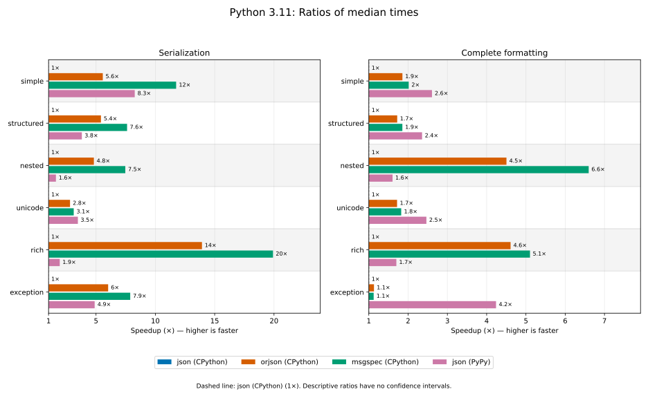

Reference: json (CPython) (1×).

??? note "Speedup values"

    | Layer | Workload | json (CPython) | orjson (CPython) | msgspec (CPython) | json (PyPy) |
    | --- | --- | ---: | ---: | ---: | ---: |
    | serialization | simple | 1× | 7.7× | 13× | 4.3× |
    | serialization | structured | 1× | 6.8× | 8.1× | 2.3× |
    | serialization | nested | 1× | 4.9× | 7.3× | 0.93× |
    | serialization | unicode | 1× | 3× | 3.3× | 2× |
    | serialization | rich | 1× | 4.3× | 6.6× | 1.3× |
    | serialization | exception | 1× | 8.2× | 8.3× | 2.6× |
    | formatting | simple | 1× | 1.9× | 2.1× | 1.3× |
    | formatting | structured | 1× | 1.8× | 1.9× | 1.2× |
    | formatting | nested | 1× | 4.4× | 6.4× | 0.93× |
    | formatting | unicode | 1× | 1.8× | 1.9× | 1.4× |
    | formatting | rich | 1× | 3× | 3.8× | 1.1× |
    | formatting | exception | 1× | 1.1× | 1.1× | 1.5× |

### Python 3.12

**CPython 3.12.3**. Measured: 2026-10-28T02:19:33.887630+00:00. Revision: `3a26fc4e64acfc167d24623c96ccd72802f834d0`.

Environment: Linux 6.17.0-1022-azure, x86_64; AMD EPYC 9V74 80-Core Processor.

Dependencies: `msgspec==0.22.0`, `orjson==3.13.0`, `pytest==9.1.1`, `pytest-benchmark==5.3.0`, `python-json-logger==4.3.0.dev1`.

**PyPy 3.12.15**. Measured: 2026-10-28T02:26:07.723934+00:00. Revision: `3a26fc4e64acfc167d24623c96ccd72802f834d0`.

Environment: Linux 6.17.0-1022-azure, x86_64; AMD EPYC 9V74 80-Core Processor. PyPy release: 8.0.1.

Dependencies: `pytest==9.1.1`, `pytest-benchmark==5.3.0`, `python-json-logger==4.3.0.dev1`.

#### Times and variation

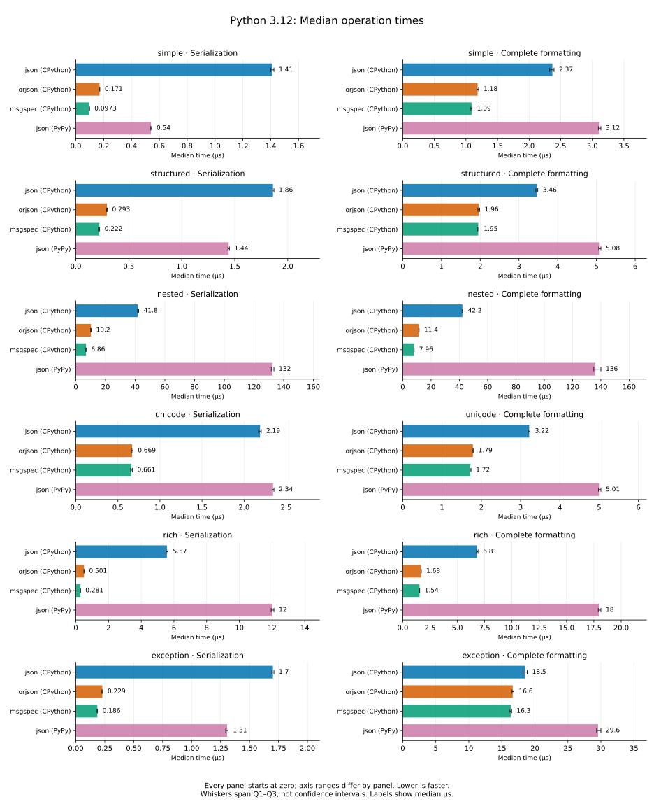

??? note "Timing statistics"

    | Layer | Workload | Encoder | Median (µs) | IQR (µs) | Mean ± SD (µs) | Rounds × iterations |
    | --- | --- | --- | ---: | ---: | ---: | ---: |
    | serialization | simple | json (CPython) | 2.25 | 0.024 | 2.28 ± 0.19 | 45,282 × 10 |
    | serialization | simple | orjson (CPython) | 0.283 | 0.012 | 0.292 ± 0.062 | 198,099 × 17 |
    | serialization | simple | msgspec (CPython) | 0.191 | 0.0026 | 0.194 ± 0.017 | 54,031 × 100 |
    | serialization | simple | json (PyPy) | 0.513 | 0.015 | 0.533 ± 2.1 | 189,108 × 11 |
    | serialization | structured | json (CPython) | 3.18 | 0.044 | 3.25 ± 1.1 | 162,629 × 2 |
    | serialization | structured | orjson (CPython) | 0.521 | 0.011 | 0.528 ± 0.096 | 199,323 × 10 |
    | serialization | structured | msgspec (CPython) | 0.427 | 0.0099 | 0.433 ± 0.075 | 189,108 × 13 |
    | serialization | structured | json (PyPy) | 1.39 | 0.024 | 1.41 ± 0.16 | 74,683 × 10 |
    | serialization | nested | json (CPython) | 81.7 | 0.69 | 82.8 ± 4.4 | 12,510 × 1 |
    | serialization | nested | orjson (CPython) | 22.7 | 0.17 | 23 ± 1.9 | 44,755 × 1 |
    | serialization | nested | msgspec (CPython) | 14.6 | 0.17 | 14.8 ± 1.6 | 70,867 × 1 |
    | serialization | nested | json (PyPy) | 120 | 2.2 | 123 ± 12 | 8,688 × 1 |
    | serialization | unicode | json (CPython) | 3.89 | 0.045 | 3.95 ± 0.55 | 132,767 × 2 |
    | serialization | unicode | orjson (CPython) | 1.24 | 0.016 | 1.26 ± 0.17 | 81,847 × 10 |
    | serialization | unicode | msgspec (CPython) | 1.13 | 0.012 | 1.15 ± 0.14 | 89,630 × 10 |
    | serialization | unicode | json (PyPy) | 2.01 | 0.1 | 2.02 ± 0.21 | 53,511 × 10 |
    | serialization | rich | json (CPython) | 15.3 | 0.2 | 15.5 ± 1.9 | 67,834 × 1 |
    | serialization | rich | orjson (CPython) | 3.45 | 0.054 | 3.5 ± 0.52 | 149,701 × 2 |
    | serialization | rich | msgspec (CPython) | 2.15 | 0.027 | 2.18 ± 0.21 | 47,706 × 10 |
    | serialization | rich | json (PyPy) | 13.1 | 0.23 | 13.6 ± 33 | 80,007 × 1 |
    | serialization | exception | json (CPython) | 2.83 | 0.039 | 2.88 ± 0.44 | 181,885 × 2 |
    | serialization | exception | orjson (CPython) | 0.41 | 0.0085 | 0.416 ± 0.065 | 195,008 × 13 |
    | serialization | exception | msgspec (CPython) | 0.361 | 0.006 | 0.366 ± 0.053 | 190,187 × 15 |
    | serialization | exception | json (PyPy) | 1.17 | 0.016 | 1.19 ± 0.16 | 87,658 × 10 |
    | formatting | simple | json (CPython) | 4.23 | 0.07 | 4.29 ± 0.53 | 120,584 × 2 |
    | formatting | simple | orjson (CPython) | 2.22 | 0.027 | 2.25 ± 0.18 | 46,551 × 10 |
    | formatting | simple | msgspec (CPython) | 1.99 | 0.026 | 2.05 ± 0.45 | 51,285 × 10 |
    | formatting | simple | json (PyPy) | 3.14 | 0.05 | 3.3 ± 19 | 166,141 × 2 |
    | formatting | structured | json (CPython) | 6.36 | 0.1 | 6.49 ± 1.2 | 161,839 × 1 |
    | formatting | structured | orjson (CPython) | 3.59 | 0.066 | 3.63 ± 0.45 | 146,413 × 2 |
    | formatting | structured | msgspec (CPython) | 3.41 | 0.061 | 3.46 ± 0.44 | 153,870 × 2 |
    | formatting | structured | json (PyPy) | 5.2 | 0.081 | 5.43 ± 22 | 198,138 × 1 |
    | formatting | nested | json (CPython) | 83.2 | 0.8 | 84.1 ± 3.3 | 12,369 × 1 |
    | formatting | nested | orjson (CPython) | 24.5 | 0.2 | 24.8 ± 1.7 | 41,467 × 1 |
    | formatting | nested | msgspec (CPython) | 16.4 | 0.18 | 16.6 ± 1.3 | 62,720 × 1 |
    | formatting | nested | json (PyPy) | 122 | 2.9 | 125 ± 37 | 8,500 × 1 |
    | formatting | unicode | json (CPython) | 5.87 | 0.08 | 5.95 ± 0.81 | 173,974 × 1 |
    | formatting | unicode | orjson (CPython) | 3.28 | 0.06 | 3.38 ± 1.3 | 161,031 × 2 |
    | formatting | unicode | msgspec (CPython) | 3.25 | 0.056 | 3.29 ± 0.41 | 159,745 × 2 |
    | formatting | unicode | json (PyPy) | 4.71 | 0.09 | 4.88 ± 13 | 111,434 × 2 |
    | formatting | rich | json (CPython) | 17.8 | 0.23 | 18.1 ± 1.9 | 57,684 × 1 |
    | formatting | rich | orjson (CPython) | 6.13 | 0.12 | 6.33 ± 1.2 | 169,521 × 1 |
    | formatting | rich | msgspec (CPython) | 4.68 | 0.09 | 4.74 ± 0.51 | 108,296 × 2 |
    | formatting | rich | json (PyPy) | 18 | 0.3 | 18.9 ± 59 | 57,817 × 1 |
    | formatting | exception | json (CPython) | 34.2 | 0.53 | 35.4 ± 6.8 | 29,950 × 1 |
    | formatting | exception | orjson (CPython) | 30.1 | 0.45 | 30.7 ± 3 | 34,887 × 1 |
    | formatting | exception | msgspec (CPython) | 30.5 | 0.49 | 31.1 ± 3.1 | 33,882 × 1 |
    | formatting | exception | json (PyPy) | 23.1 | 0.43 | 25.8 ± 90 | 45,223 × 1 |

#### Speedup

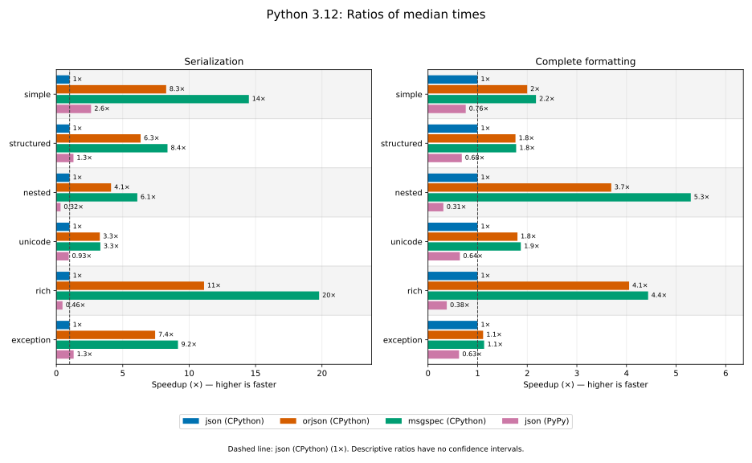

Reference: json (CPython) (1×).

??? note "Speedup values"

    | Layer | Workload | json (CPython) | orjson (CPython) | msgspec (CPython) | json (PyPy) |
    | --- | --- | ---: | ---: | ---: | ---: |
    | serialization | simple | 1× | 7.9× | 12× | 4.4× |
    | serialization | structured | 1× | 6.1× | 7.4× | 2.3× |
    | serialization | nested | 1× | 3.6× | 5.6× | 0.68× |
    | serialization | unicode | 1× | 3.1× | 3.4× | 1.9× |
    | serialization | rich | 1× | 4.4× | 7.1× | 1.2× |
    | serialization | exception | 1× | 6.9× | 7.9× | 2.4× |
    | formatting | simple | 1× | 1.9× | 2.1× | 1.3× |
    | formatting | structured | 1× | 1.8× | 1.9× | 1.2× |
    | formatting | nested | 1× | 3.4× | 5.1× | 0.68× |
    | formatting | unicode | 1× | 1.8× | 1.8× | 1.2× |
    | formatting | rich | 1× | 2.9× | 3.8× | 0.99× |
    | formatting | exception | 1× | 1.1× | 1.1× | 1.5× |

### Python 3.13

**CPython 3.13.18**. Measured: 2026-10-28T02:21:07.877875+00:00. Revision: `3a26fc4e64acfc167d24623c96ccd72802f834d0`.

Environment: Linux 6.17.0-1022-azure, x86_64; AMD EPYC 9V74 80-Core Processor.

Dependencies: `msgspec==0.22.0`, `orjson==3.13.0`, `pytest==9.1.1`, `pytest-benchmark==5.3.0`, `python-json-logger==4.3.0.dev1`.

#### Times and variation

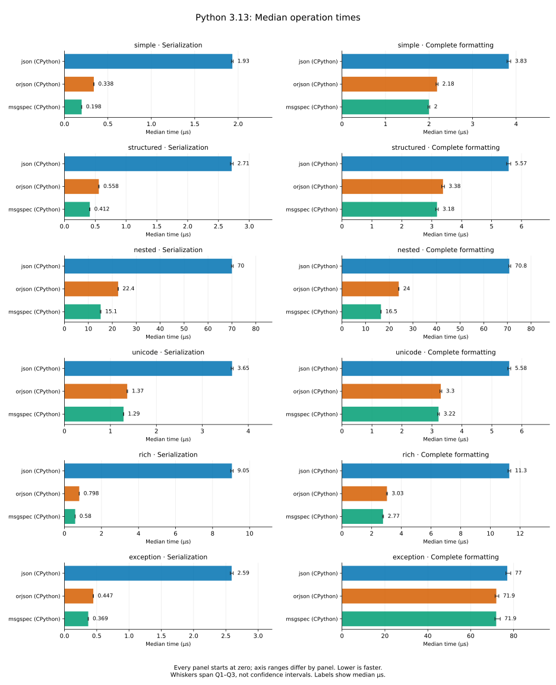

??? note "Timing statistics"

    | Layer | Workload | Encoder | Median (µs) | IQR (µs) | Mean ± SD (µs) | Rounds × iterations |
    | --- | --- | --- | ---: | ---: | ---: | ---: |
    | serialization | simple | json (CPython) | 1.9 | 0.024 | 1.94 ± 0.23 | 55,136 × 10 |
    | serialization | simple | orjson (CPython) | 0.283 | 0.0043 | 0.288 ± 0.047 | 191,315 × 19 |
    | serialization | simple | msgspec (CPython) | 0.185 | 0.0027 | 0.191 ± 0.038 | 53,283 × 100 |
    | serialization | structured | json (CPython) | 2.74 | 0.056 | 2.84 ± 0.58 | 190,913 × 2 |
    | serialization | structured | orjson (CPython) | 0.495 | 0.0092 | 0.504 ± 0.12 | 187,688 × 11 |
    | serialization | structured | msgspec (CPython) | 0.411 | 0.0085 | 0.417 ± 0.058 | 192,753 × 13 |
    | serialization | nested | json (CPython) | 67 | 0.71 | 68 ± 3.2 | 15,233 × 1 |
    | serialization | nested | orjson (CPython) | 21.4 | 0.13 | 21.8 ± 1.9 | 47,345 × 1 |
    | serialization | nested | msgspec (CPython) | 14.6 | 0.18 | 14.8 ± 1.3 | 70,867 × 1 |
    | serialization | unicode | json (CPython) | 3.73 | 0.045 | 3.78 ± 0.46 | 140,430 × 2 |
    | serialization | unicode | orjson (CPython) | 1.33 | 0.021 | 1.35 ± 0.15 | 77,767 × 10 |
    | serialization | unicode | msgspec (CPython) | 1.21 | 0.013 | 1.23 ± 0.12 | 84,761 × 10 |
    | serialization | rich | json (CPython) | 13.4 | 0.18 | 13.7 ± 1.7 | 77,227 × 1 |
    | serialization | rich | orjson (CPython) | 3.35 | 0.065 | 3.4 ± 0.42 | 155,280 × 2 |
    | serialization | rich | msgspec (CPython) | 2.11 | 0.03 | 2.13 ± 0.15 | 50,000 × 10 |
    | serialization | exception | json (CPython) | 2.6 | 0.049 | 2.63 ± 0.36 | 199,721 × 2 |
    | serialization | exception | orjson (CPython) | 0.409 | 0.0085 | 0.414 ± 0.058 | 199,323 × 13 |
    | serialization | exception | msgspec (CPython) | 0.362 | 0.008 | 0.366 ± 0.05 | 188,751 × 15 |
    | formatting | simple | json (CPython) | 3.68 | 0.065 | 3.72 ± 0.45 | 142,634 × 2 |
    | formatting | simple | orjson (CPython) | 2.02 | 0.029 | 2.05 ± 0.21 | 51,154 × 10 |
    | formatting | simple | msgspec (CPython) | 1.81 | 0.024 | 1.83 ± 0.15 | 57,817 × 10 |
    | formatting | structured | json (CPython) | 5.64 | 0.11 | 5.75 ± 1.2 | 187,688 × 1 |
    | formatting | structured | orjson (CPython) | 3.35 | 0.065 | 3.39 ± 0.42 | 156,740 × 2 |
    | formatting | structured | msgspec (CPython) | 3.2 | 0.065 | 3.25 ± 0.46 | 164,231 × 2 |
    | formatting | nested | json (CPython) | 68.5 | 0.64 | 69.4 ± 3.4 | 14,892 × 1 |
    | formatting | nested | orjson (CPython) | 23.2 | 0.18 | 23.5 ± 1.7 | 43,930 × 1 |
    | formatting | nested | msgspec (CPython) | 16.3 | 0.19 | 16.5 ± 1.3 | 63,400 × 1 |
    | formatting | unicode | json (CPython) | 5.6 | 0.1 | 5.67 ± 0.82 | 189,466 × 1 |
    | formatting | unicode | orjson (CPython) | 3.23 | 0.055 | 3.28 ± 0.46 | 162,101 × 2 |
    | formatting | unicode | msgspec (CPython) | 3.2 | 0.06 | 3.25 ± 0.44 | 160,798 × 2 |
    | formatting | rich | json (CPython) | 15.9 | 0.25 | 16.2 ± 1.5 | 65,390 × 1 |
    | formatting | rich | orjson (CPython) | 5.97 | 0.14 | 6.06 ± 0.86 | 177,684 × 1 |
    | formatting | rich | msgspec (CPython) | 4.78 | 0.08 | 4.84 ± 0.53 | 112,196 × 2 |
    | formatting | exception | json (CPython) | 48.8 | 1 | 50.9 ± 9.4 | 21,119 × 1 |
    | formatting | exception | orjson (CPython) | 46 | 0.77 | 47.1 ± 4.2 | 22,469 × 1 |
    | formatting | exception | msgspec (CPython) | 45.6 | 0.76 | 46.7 ± 4.3 | 22,540 × 1 |

#### Speedup

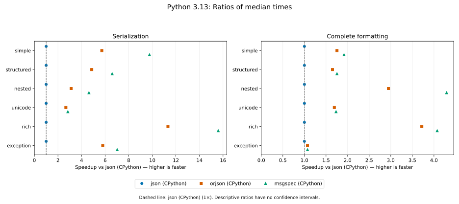

Reference: json (CPython) (1×).

??? note "Speedup values"

    | Layer | Workload | json (CPython) | orjson (CPython) | msgspec (CPython) |
    | --- | --- | ---: | ---: | ---: |
    | serialization | simple | 1× | 6.7× | 10× |
    | serialization | structured | 1× | 5.5× | 6.7× |
    | serialization | nested | 1× | 3.1× | 4.6× |
    | serialization | unicode | 1× | 2.8× | 3.1× |
    | serialization | rich | 1× | 4× | 6.4× |
    | serialization | exception | 1× | 6.4× | 7.2× |
    | formatting | simple | 1× | 1.8× | 2× |
    | formatting | structured | 1× | 1.7× | 1.8× |
    | formatting | nested | 1× | 3× | 4.2× |
    | formatting | unicode | 1× | 1.7× | 1.7× |
    | formatting | rich | 1× | 2.7× | 3.3× |
    | formatting | exception | 1× | 1.1× | 1.1× |

### Python 3.14

**CPython 3.14.10**. Measured: 2026-10-28T02:22:40.796372+00:00. Revision: `3a26fc4e64acfc167d24623c96ccd72802f834d0`.

Environment: Linux 6.17.0-1022-azure, x86_64; AMD EPYC 9V74 80-Core Processor.

Dependencies: `msgspec==0.22.0`, `orjson==3.13.0`, `pytest==9.1.1`, `pytest-benchmark==5.3.0`, `python-json-logger==4.3.0.dev1`.

#### Times and variation

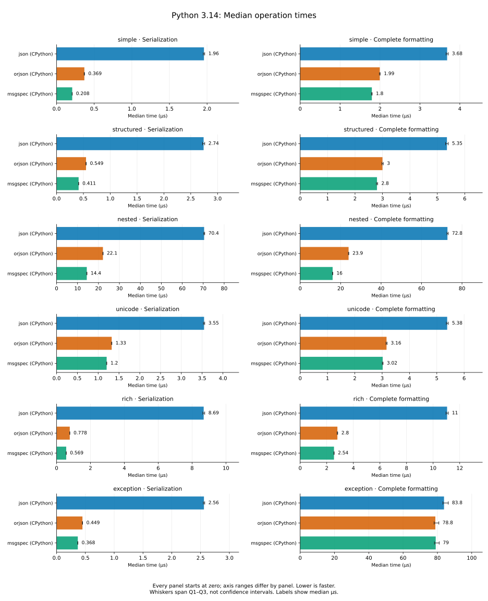

??? note "Timing statistics"

    | Layer | Workload | Encoder | Median (µs) | IQR (µs) | Mean ± SD (µs) | Rounds × iterations |
    | --- | --- | --- | ---: | ---: | ---: | ---: |
    | serialization | simple | json (CPython) | 1.9 | 0.02 | 1.94 ± 0.21 | 53,857 × 10 |
    | serialization | simple | orjson (CPython) | 0.311 | 0.0054 | 0.32 ± 0.071 | 196,541 × 17 |
    | serialization | simple | msgspec (CPython) | 0.191 | 0.0015 | 0.194 ± 0.018 | 52,888 × 100 |
    | serialization | structured | json (CPython) | 2.76 | 0.035 | 2.82 ± 0.44 | 188,395 × 2 |
    | serialization | structured | orjson (CPython) | 0.497 | 0.0074 | 0.505 ± 0.076 | 190,549 × 11 |
    | serialization | structured | msgspec (CPython) | 0.418 | 0.0085 | 0.424 ± 0.07 | 192,790 × 13 |
    | serialization | nested | json (CPython) | 68.1 | 0.5 | 69.1 ± 3.6 | 14,930 × 1 |
    | serialization | nested | orjson (CPython) | 21.6 | 0.14 | 21.8 ± 1.6 | 47,144 × 1 |
    | serialization | nested | msgspec (CPython) | 14.4 | 0.18 | 14.6 ± 1.3 | 71,526 × 1 |
    | serialization | unicode | json (CPython) | 3.87 | 0.035 | 3.93 ± 0.52 | 132,609 × 2 |
    | serialization | unicode | orjson (CPython) | 1.32 | 0.016 | 1.37 ± 0.32 | 77,221 × 10 |
    | serialization | unicode | msgspec (CPython) | 1.2 | 0.014 | 1.23 ± 0.2 | 84,126 × 10 |
    | serialization | rich | json (CPython) | 13.3 | 0.16 | 13.5 ± 1.4 | 76,983 × 1 |
    | serialization | rich | orjson (CPython) | 3.32 | 0.065 | 3.38 ± 0.5 | 161,839 × 2 |
    | serialization | rich | msgspec (CPython) | 1.99 | 0.031 | 2.02 ± 0.16 | 52,223 × 10 |
    | serialization | exception | json (CPython) | 2.56 | 0.033 | 2.61 ± 0.41 | 134,031 × 3 |
    | serialization | exception | orjson (CPython) | 0.392 | 0.0056 | 0.397 ± 0.055 | 187,688 × 14 |
    | serialization | exception | msgspec (CPython) | 0.363 | 0.0054 | 0.367 ± 0.049 | 189,108 × 15 |
    | formatting | simple | json (CPython) | 3.74 | 0.06 | 3.8 ± 0.5 | 138,505 × 2 |
    | formatting | simple | orjson (CPython) | 2.03 | 0.046 | 2.05 ± 0.15 | 51,707 × 10 |
    | formatting | simple | msgspec (CPython) | 1.8 | 0.027 | 1.82 ± 0.14 | 57,851 × 10 |
    | formatting | structured | json (CPython) | 5.34 | 0.1 | 5.43 ± 0.91 | 195,772 × 1 |
    | formatting | structured | orjson (CPython) | 3.11 | 0.07 | 3.15 ± 0.41 | 170,678 × 2 |
    | formatting | structured | msgspec (CPython) | 2.88 | 0.055 | 2.93 ± 0.39 | 181,226 × 2 |
    | formatting | nested | json (CPython) | 68.3 | 0.5 | 69.2 ± 3.3 | 14,802 × 1 |
    | formatting | nested | orjson (CPython) | 23.2 | 0.15 | 23.5 ± 1.8 | 43,814 × 1 |
    | formatting | nested | msgspec (CPython) | 16.1 | 0.19 | 16.3 ± 1.4 | 64,169 × 1 |
    | formatting | unicode | json (CPython) | 5.62 | 0.071 | 5.72 ± 0.87 | 183,520 × 1 |
    | formatting | unicode | orjson (CPython) | 3.31 | 0.05 | 3.37 ± 0.47 | 157,729 × 2 |
    | formatting | unicode | msgspec (CPython) | 3.11 | 0.049 | 3.16 ± 1.4 | 165,317 × 2 |
    | formatting | rich | json (CPython) | 15.4 | 0.19 | 15.6 ± 1.8 | 67,377 × 1 |
    | formatting | rich | orjson (CPython) | 5.69 | 0.1 | 5.8 ± 1 | 187,337 × 1 |
    | formatting | rich | msgspec (CPython) | 4.46 | 0.075 | 4.53 ± 0.54 | 118,456 × 2 |
    | formatting | exception | json (CPython) | 46.8 | 1 | 48.1 ± 4.7 | 22,194 × 1 |
    | formatting | exception | orjson (CPython) | 44 | 0.89 | 45.3 ± 4.6 | 23,589 × 1 |
    | formatting | exception | msgspec (CPython) | 44 | 0.9 | 45.3 ± 4.8 | 23,656 × 1 |

#### Speedup

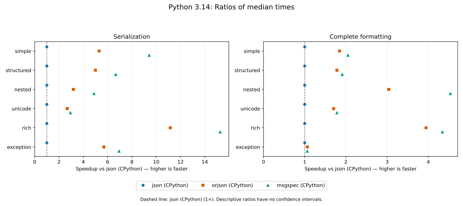

Reference: json (CPython) (1×).

??? note "Speedup values"

    | Layer | Workload | json (CPython) | orjson (CPython) | msgspec (CPython) |
    | --- | --- | ---: | ---: | ---: |
    | serialization | simple | 1× | 6.1× | 10× |
    | serialization | structured | 1× | 5.6× | 6.6× |
    | serialization | nested | 1× | 3.2× | 4.7× |
    | serialization | unicode | 1× | 2.9× | 3.2× |
    | serialization | rich | 1× | 4× | 6.7× |
    | serialization | exception | 1× | 6.5× | 7.1× |
    | formatting | simple | 1× | 1.8× | 2.1× |
    | formatting | structured | 1× | 1.7× | 1.9× |
    | formatting | nested | 1× | 2.9× | 4.3× |
    | formatting | unicode | 1× | 1.7× | 1.8× |
    | formatting | rich | 1× | 2.7× | 3.5× |
    | formatting | exception | 1× | 1.1× | 1.1× |

### Python 3.15

**CPython 3.15.2**. Measured: 2026-10-28T02:24:12.733828+00:00. Revision: `3a26fc4e64acfc167d24623c96ccd72802f834d0`.

Environment: Linux 6.17.0-1022-azure, x86_64; AMD EPYC 9V74 80-Core Processor.

Dependencies: `msgspec==0.22.0`, `orjson==3.13.0`, `pytest==9.1.1`, `pytest-benchmark==5.3.0`, `python-json-logger==4.3.0.dev1`.

#### Times and variation

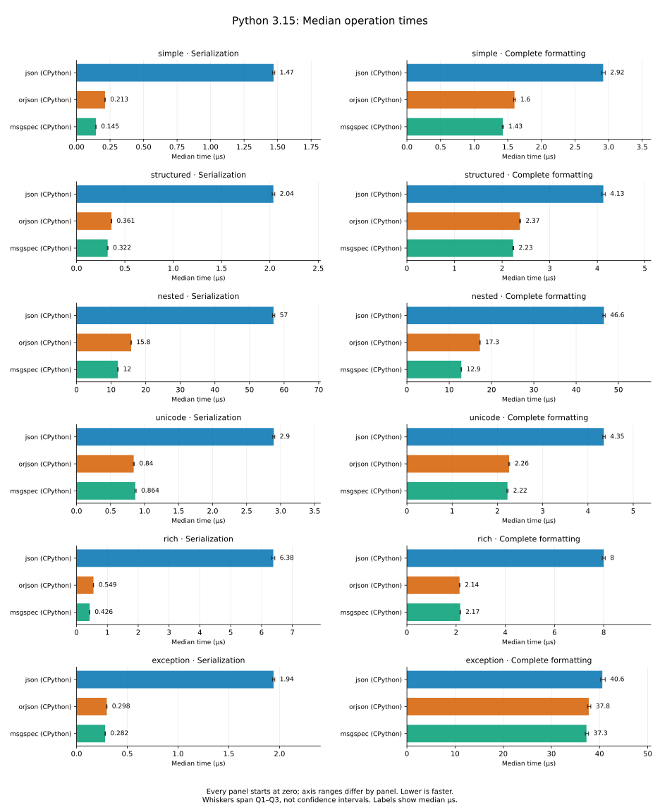

??? note "Timing statistics"

    | Layer | Workload | Encoder | Median (µs) | IQR (µs) | Mean ± SD (µs) | Rounds × iterations |
    | --- | --- | --- | ---: | ---: | ---: | ---: |
    | serialization | simple | json (CPython) | 1.86 | 0.022 | 1.9 ± 0.58 | 55,289 × 10 |
    | serialization | simple | orjson (CPython) | 0.309 | 0.0077 | 0.315 ± 0.067 | 198,531 × 17 |
    | serialization | simple | msgspec (CPython) | 0.191 | 0.0016 | 0.193 ± 0.015 | 53,368 × 100 |
    | serialization | structured | json (CPython) | 2.67 | 0.046 | 2.72 ± 0.53 | 195,389 × 2 |
    | serialization | structured | orjson (CPython) | 0.504 | 0.0083 | 0.512 ± 0.071 | 186,290 × 11 |
    | serialization | structured | msgspec (CPython) | 0.45 | 0.013 | 0.456 ± 0.066 | 198,887 × 12 |
    | serialization | nested | json (CPython) | 55.5 | 0.6 | 56.5 ± 9.4 | 18,474 × 1 |
    | serialization | nested | orjson (CPython) | 21 | 0.13 | 21.2 ± 1.6 | 48,401 × 1 |
    | serialization | nested | msgspec (CPython) | 14.9 | 0.17 | 15.1 ± 1.4 | 69,195 × 1 |
    | serialization | unicode | json (CPython) | 3.68 | 0.04 | 3.74 ± 0.61 | 138,870 × 2 |
    | serialization | unicode | orjson (CPython) | 1.08 | 0.015 | 1.1 ± 0.13 | 96,099 × 10 |
    | serialization | unicode | msgspec (CPython) | 1.07 | 0.01 | 1.09 ± 0.12 | 94,287 × 10 |
    | serialization | rich | json (CPython) | 12.4 | 0.19 | 12.6 ± 1.3 | 83,140 × 1 |
    | serialization | rich | orjson (CPython) | 3.19 | 0.055 | 3.25 ± 0.51 | 163,962 × 2 |
    | serialization | rich | msgspec (CPython) | 1.95 | 0.027 | 1.98 ± 0.16 | 53,000 × 10 |
    | serialization | exception | json (CPython) | 2.45 | 0.022 | 2.48 ± 0.18 | 41,674 × 10 |
    | serialization | exception | orjson (CPython) | 0.395 | 0.0064 | 0.4 ± 0.057 | 186,255 × 14 |
    | serialization | exception | msgspec (CPython) | 0.371 | 0.0071 | 0.377 ± 0.055 | 198,531 × 14 |
    | formatting | simple | json (CPython) | 3.58 | 0.06 | 3.65 ± 0.54 | 145,561 × 2 |
    | formatting | simple | orjson (CPython) | 1.96 | 0.026 | 1.99 ± 0.16 | 52,387 × 10 |
    | formatting | simple | msgspec (CPython) | 1.75 | 0.024 | 1.77 ± 0.16 | 58,597 × 10 |
    | formatting | structured | json (CPython) | 5.08 | 0.08 | 5.16 ± 0.54 | 102,733 × 2 |
    | formatting | structured | orjson (CPython) | 3 | 0.055 | 3.04 ± 0.4 | 174,551 × 2 |
    | formatting | structured | msgspec (CPython) | 2.85 | 0.05 | 2.89 ± 0.41 | 182,883 × 2 |
    | formatting | nested | json (CPython) | 58.9 | 0.79 | 60 ± 4.9 | 17,417 × 1 |
    | formatting | nested | orjson (CPython) | 23.2 | 0.22 | 23.5 ± 1.8 | 43,987 × 1 |
    | formatting | nested | msgspec (CPython) | 16.5 | 0.19 | 16.7 ± 1.4 | 62,251 × 1 |
    | formatting | unicode | json (CPython) | 5.42 | 0.08 | 5.52 ± 0.89 | 189,826 × 1 |
    | formatting | unicode | orjson (CPython) | 2.94 | 0.05 | 3 ± 0.46 | 176,741 × 2 |
    | formatting | unicode | msgspec (CPython) | 2.9 | 0.045 | 2.94 ± 0.4 | 178,955 × 2 |
    | formatting | rich | json (CPython) | 14.8 | 0.21 | 15.1 ± 1.4 | 69,877 × 1 |
    | formatting | rich | orjson (CPython) | 5.55 | 0.1 | 5.65 ± 0.84 | 189,826 × 1 |
    | formatting | rich | msgspec (CPython) | 4.38 | 0.07 | 4.44 ± 0.53 | 119,575 × 2 |
    | formatting | exception | json (CPython) | 50.4 | 1.1 | 51.9 ± 4.9 | 20,419 × 1 |
    | formatting | exception | orjson (CPython) | 47.1 | 0.92 | 48.3 ± 4.6 | 21,878 × 1 |
    | formatting | exception | msgspec (CPython) | 47.2 | 0.95 | 48.5 ± 4.7 | 21,840 × 1 |

#### Speedup

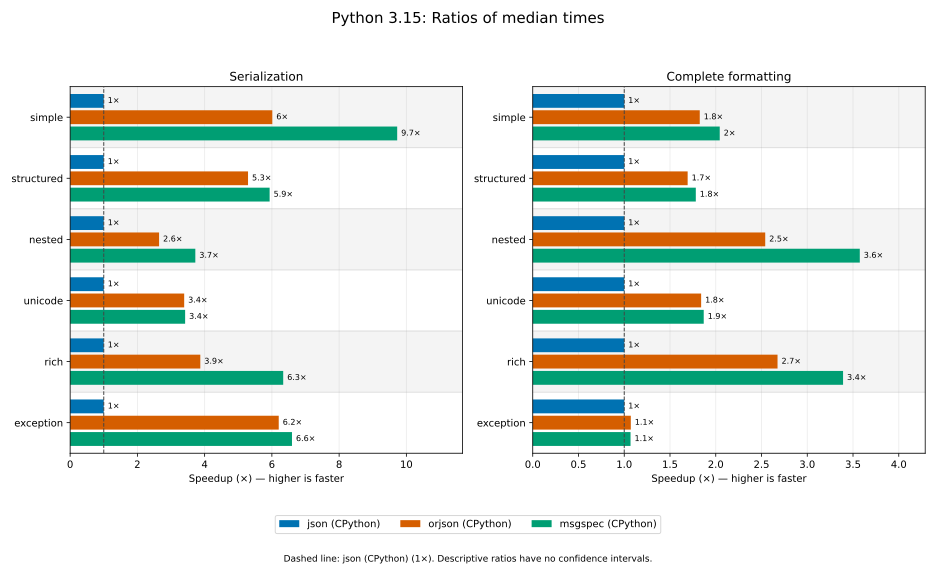

Reference: json (CPython) (1×).

??? note "Speedup values"

    | Layer | Workload | json (CPython) | orjson (CPython) | msgspec (CPython) |
    | --- | --- | ---: | ---: | ---: |
    | serialization | simple | 1× | 6× | 9.7× |
    | serialization | structured | 1× | 5.3× | 5.9× |
    | serialization | nested | 1× | 2.6× | 3.7× |
    | serialization | unicode | 1× | 3.4× | 3.4× |
    | serialization | rich | 1× | 3.9× | 6.3× |
    | serialization | exception | 1× | 6.2× | 6.6× |
    | formatting | simple | 1× | 1.8× | 2× |
    | formatting | structured | 1× | 1.7× | 1.8× |
    | formatting | nested | 1× | 2.5× | 3.6× |
    | formatting | unicode | 1× | 1.8× | 1.9× |
    | formatting | rich | 1× | 2.7× | 3.4× |
    | formatting | exception | 1× | 1.1× | 1.1× |

<!-- benchmark-results:end -->
